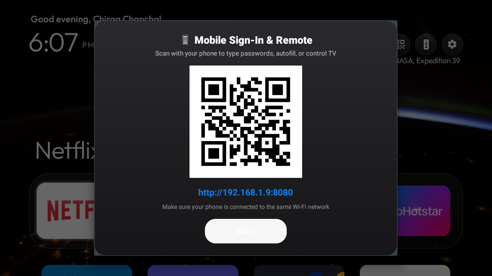

# 🍎 TrimOS

<div align="center">


### **Το εξαιρετικά καθαρό, χωρίς διαφημίσεις λειτουργικό περιβάλλον για Android TV & Google TV**
*Μετατρέψτε οποιαδήποτε αργή smart TV με ενοχλητικές διαφημίσεις σε μια ταχύτατη εμπειρία εμπνευσμένη από το Apple TV.*

[](LICENSE)
[](https://android.com/tv)
[](#)
[](#)
[](#)

[English](README.md) • [Deutsch](README.de.md) • [Español](README.es.md) • [Français](README.fr.md) • [Italiano](README.it.md) • [Português (Brasil)](README.pt-BR.md) • [Nederlands](README.nl.md) • [Türkçe](README.tr.md) • [Ελληνικά](README.el.md) • [עברית](README.he.md) • [Українська](README.uk.md) • [Oʻzbekcha](README.uz.md) • [Tiếng Việt](README.vi.md) • [日本語](README.ja.md) • [简体中文](README.zh-CN.md) • [繁體中文](README.zh-TW.md)

[Χαρακτηριστικά](#-γιατί-το-trimos) • [Στιγμιότυπα](#-οπτική-παρουσίαση) • [Γρήγορη Εκκίνηση](#-γρήγορη-εκκίνηση) • [Υποστηριζόμενες TV](#-υποστηριζόμενες-τηλεοράσεις--προφίλ) • [Κινητό Τηλεχειριστήριο](#-σύνδεση-από-κινητό--εικονικό-touchpad) • [Επαναφορά](#-ασφάλεια--επαναφορά-με-1-κλικ)

</div>

---

## ⚡ Γιατί το TrimOS;

Οι σύγχρονες έξυπνες τηλεοράσεις υποφέρουν από ενοχλητικές βιντεοδιαφημίσεις πλήρους οθόνης, αυτόματες αναπαραγωγές, προωθητικά καρουζέλ και βαριές υπηρεσίες τηλεμετρίας που καταναλώνουν έως και το 80% της μνήμης RAM της τηλεόρασής σας.

Το **TrimOS** αντικαθιστά πλήρως τις βαριές προεγκατεστημένες εφαρμογές του κατασκευαστή (Xiaomi PatchWall, προτάσεις Google TV, διαφημίσεις Fire TV κ.λπ.) με ένα εξαιρετικά γρήγορο, καθαρό περιβάλλον εμπνευσμένο από το Apple TV:

| Δυνατότητα | Εργοστασιακή Smart TV | TrimOS |
| :--- | :---: | :---: |
| **Διαφημίσεις & Αυτόματα Βίντεο** | ❌ Παντού και ενοχλητικά | 🟢 **100% Χωρίς Διαφημίσεις** |
| **Κατανάλωση Μνήμης RAM** | ❌ 600 MB – 1.2 GB | 🟢 **~22 MB (Εξαιρετικά ελαφρύ)** |
| **Καθυστερήσεις & Κολλήματα** | ❌ Αργό με σπασίματα | 🟢 **Απόλυτα ομαλό στα 60 fps** |
| **YouTube Χωρίς Διαφημίσεις** | ❌ Συνεχείς διακοπές 30 δευτ. | 🟢 **SmartTube με SponsorBlock** |
| **Πληκτρολόγηση Κωδικών** | ❌ Εξαντλητικό με το τηλεχειριστήριο | 🟢 **Σάρωση QR & πληκτρολόγηση από το κινητό** |
| **Εικονικό Ποντίκι / Touchpad** | ❌ Δεν υπάρχει | 🟢 **Πλήρες trackpad με Drag & Drop** |
| **Προσαρμογή Θεμάτων** | ❌ 1 στατικό θέμα κατασκευαστή | 🟢 **32 Ενσωματωμένα Θέματα** |
| **Ενιαία Αναζήτηση Streaming** | ❌ Περιορισμένη σε διαφημιζόμενους | 🟢 **Κοινή αναζήτηση σε όλες τις πλατφόρμες** |
| **Αντιστοίχιση Πλήκτρων** | ❌ Κλειδωμένα πλήκτρα χορηγών | 🟢 **Πλήρως επαναπρογραμματιζόμενο** |
| **Απαιτείται Root** | ⚠️ Επικίνδυνο και πολύπλοκο | 🟢 **Χωρίς Root (Ασφαλές ADB)** |

---

## 📸 Οπτική Παρουσίαση

### 1. Περιβάλλον Apple TV & Προσωποποιημένοι Χαιρετισμοί
> Καθαρή αρχική οθόνη με δορυφορικές εναέριες λήψεις 4K της NASA, ομαλές κινήσεις καρτών και προσαρμόσιμα μηνύματα υποδοχής για τα μέλη της οικογένειας.
<div align="center">
  
</div>

---

### 2. 📱 Κινητό Τηλεχειριστήριο & Εικονικό Touchpad με Σύρσιμο
> Ανοίξτε τον κωδικό QR ή μεταβείτε στη διεύθυνση `http://<tv-ip>:8080` από οποιοδήποτε smartphone στο Wi-Fi. Ελέγξτε έναν ομαλό δείκτη ποντικιού, πατήστε για κλικ, κρατήστε πατημένο για σύρσιμο και χρησιμοποιήστε κουμπιά κύλισης.
<div align="center">
  
</div>

---

### 3. 📺 Ενσωμάτωση SmartTube Χωρίς Διαφημίσεις
> Προρυθμισμένο SmartTube με αυτόματο SponsorBlock (παραλείπει αυτόματα χορηγίες, εισαγωγές και ενοχλητικές υπενθυμίσεις) και απρόσκοπτη αναπαραγωγή 4K.
<div align="center">
  
</div>

---

### 4. 🎨 32 Ενσωματωμένα Θέματα (Επιλογή στην Οθόνη)
> Άμεση εναλλαγή μεταξύ 32 θεμάτων απευθείας στην τηλεόραση ή στο κινητό σας: **Aerial**, **Minimal (Απόλυτο Μαύρο OLED)**, **Midnight Glass**, **Βόρειο Σέλας**, **Κινηματογράφος**, **Retro 80s Synthwave**, **Εορταστικά Θέματα** και άλλα.
<div align="center">
  
</div>

---

### 5. 🔍 Ενιαία Αναζήτηση Streaming
> Αναζητήστε με μία μόνο κίνηση ταυτόχρονα σε Netflix, SmartTube, Amazon Prime Video και Disney+ ανά τίτλο, ηθοποιό ή είδος.
<div align="center">
  
</div>

---

### 6. 📱 Κωδικός QR & Εύκολη Σύνδεση από Κινητό
> Μην πληκτρολογείτε ποτέ ξανά δύσκολους κωδικούς με τα βελάκια του τηλεχειριστηρίου. Σαρώστε το QR και χρησιμοποιήστε το πληκτρολόγιο του κινητού σας για να επικολλήσετε κείμενο απευθείας στην τηλεόραση.
<div align="center">
  
</div>

---

### 7. 🎛️ Επαναπρογραμματισμός Πλήκτρων Τηλεχειριστηρίου
> Αντιστοιχίστε τα έγχρωμα πλήκτρα (Κόκκινο/Πράσινο/Κίτρινο/Μπλε), Μενού, Πίσω ή αριθμούς σε λειτουργίες όπως: Καθαριστής RAM, Ενιαία Αναζήτηση, Εναλλαγή Θεμάτων ή αγαπημένες εφαρμογές.
<div align="center">
  
</div>

---

### 8. 🧹 Καθαρισμός RAM & Βελτιστοποίηση με 1 Κλικ
> Απελευθερώστε τη μνήμη RAM της τηλεόρασης αμέσως. Τερματίζει με ασφάλεια τις παρασκηνιακές προσωρινές διεργασίες και εμφανίζει τα megabytes που απελευθερώθηκαν.
<div align="center">
  
</div>

---

### 9. 🌌 Εναέρια Προφύλαξη Οθόνης Στυλ Apple TV
> Δυναμική προφύλαξη οθόνης με δορυφορικές φωτογραφίες υψηλής ανάλυσης της Γης από τη NASA, διακριτική λάμψη και κομψό ψηφιακό ρολόι.
<div align="center">
  
</div>

---

## 🚀 Γρήγορη Εκκίνηση

### Προαπαιτούμενα
1. **Ενεργοποίηση Επιλογών Προγραμματιστή & Εντοπισμού Σφαλμάτων ADB στην τηλεόραση**:
   - Μεταβείτε στις **Ρυθμίσεις** της TV → **Προτιμήσεις συσκευής** → **Σχετικά**.
   - Πατήστε 7 φορές συνεχόμενα στον **Αριθμό κατασκευής / Build** μέχρι να εμφανιστεί η ειδοποίηση *"Είστε πλέον προγραμματιστής!"*.
   - Επιστρέψτε στις **Επιλογές για προγραμματιστές** και ενεργοποιήστε τον **Εντοπισμό σφαλμάτων USB** και τον **Εντοπισμό σφαλμάτων δικτύου / ADB**.
2. Βεβαιωθείτε ότι ο υπολογιστής και η τηλεόραση είναι συνδεδεμένα στο ίδιο δίκτυο Wi-Fi.

---

### Αυτοματοποιημένη Εγκατάσταση με 1 Κλικ (Προτείνεται)

Κλωνοποιήστε το αποθετήριο και εκτελέστε το πρόγραμμα εγκατάστασης:

```bash
git clone https://github.com/chiragchanchal/TrimOS.git
cd TrimOS
```

#### Σε Windows:
```powershell
python trimos.py install --ip <IP_ΤΗΣ_ΤΗΛΕΟΡΑΣΗΣ>
# ή κάντε διπλό κλικ στο αρχείο trimos.bat
```

#### Σε macOS / Linux:
```bash
python3 trimos.py install --ip <IP_ΤΗΣ_ΤΗΛΕΟΡΑΣΗΣ>
```

*Το εργαλείο θα αναγνωρίσει αυτόματα τον κατασκευαστή της τηλεόρασής σας, θα εγκαταστήσει το TrimOS APK, θα προστατεύσει μόνιμα το πλήκτρο Αρχικής Οθόνης (Home), θα απενεργοποιήσει με ασφάλεια τις διαφημίσεις και θα εγκαταστήσει το κατάλληλο SmartTube για τον επεξεργαστή σας.*

---

### Χειροκίνητη Εγκατάσταση (Χωρίς Python)

Εάν έχετε ήδη εγκατεστημένο το `adb` στον υπολογιστή σας:

```bash
# 1. Σύνδεση στην τηλεόραση
adb connect <IP_ΤΗΣ_ΤΗΛΕΟΡΑΣΗΣ>:5555

# 2. Εγκατάσταση TrimOS
adb install -r -g release/TrimOS-v1.0.apk

# 3. Ενεργοποίηση υπηρεσίας προσβασιμότητας για πλήκτρο Home και Touchpad
adb shell settings put secure enabled_accessibility_services com.gathin.tvhome/.HomeKeyService
adb shell settings put secure accessibility_enabled 1

# 4. (Προαιρετικό) Εγκατάσταση SmartTube
# Για τηλεοράσεις 32-bit (Mi TV 4A/4C, FireStick κ.λπ.):
adb install -r release/SmartTube-v32.71-armeabi-v7a.apk
# Για τηλεοράσεις 64-bit (Shield TV, σύγχρονες Google TV):
adb install -r release/SmartTube-v32.71-arm64-v8a.apk

# 5. Εκκίνηση TrimOS
adb shell am start -n com.gathin.tvhome/.MainActivity
```

---

## 📺 Υποστηριζόμενες Τηλεοράσεις & Προφίλ

Το TrimOS διαθέτει εξειδικευμένα προφίλ προσαρμοσμένα στις ιδιαιτερότητες κάθε κατασκευαστή:

| Μάρκα / Πλατφόρμα | Δοκιμασμένες Συσκευές | Τι καθαρίζει και βελτιστοποιεί το TrimOS |
| :--- | :--- | :--- |
| **Xiaomi / Redmi** | Mi TV 4A, 4C, 5X, Σειρά X, Horizon, Redmi TV | Απενεργοποιεί το PatchWall, διαφημιστικά βίντεο και προωθητικά κανάλια. Διατηρεί ανέπαφα τα HDMI και CEC. |
| **Google TV** | Chromecast με Google TV (HD/4K), Sony Bravia, TCL | Απενεργοποιεί τα καρουζέλ διαφημίσεων του `launcherx`. Το Google Cast και το Play Store λειτουργούν κανονικά. |
| **Βασικό Android TV** | Sony Bravia, TCL, Hisense, Philips, Sharp, Skyworth | Αντικαθιστά το βαρύ Leanback launcher. Οι ρυθμίσεις εικόνας και ήχου παραμένουν πλήρως προσβάσιμες. |
| **Amazon Fire TV** | Fire TV Stick 4K / Max, Fire TV Cube, Σειρά Omni | Παρακάμπτει την εμπορική αρχική οθόνη του Fire OS και συνδέει το πλήκτρο Home απευθείας στο TrimOS. |
| **OnePlus TV** | OnePlus TV Q1, U1S, Y1S | Καταργεί το OxygenPlay και τις παρασκηνιακές υπηρεσίες προτάσεων. |
| **Κουτιά Android TV** | Nvidia Shield TV, Mecool, Dynalink, Formuler, X96 | Καθαρή εμπειρία στα 60 fps με ελάχιστη χρήση μνήμης. |

---

## 📱 Σύνδεση από Κινητό & Εικονικό Touchpad

Κάθε τηλεόραση με TrimOS διαθέτει τοπικό διακομιστή web στο οικιακό σας δίκτυο, χωρίς ανάγκη σύνδεσης στο cloud:

1. Πατήστε το **εικονίδιο QR** στην επάνω μπάρα της TV (ή ανοίξτε `http://<tv-ip>:8080` στο πρόγραμμα περιήγησης του κινητού).
2. **Εικονικό Touchpad**:
   - **Κίνηση δακτύλου**: Ομαλή κίνηση του δείκτη στην οθόνη.
   - **Άγγιγμα**: Κλικ.
   - **Λειτουργία Σύρσιμου**: Ενεργοποιήστε το **Drag Mode: ON** για μετακίνηση στοιχείων.
   - **Κουμπιά Κύλισης**: Γρήγορη πλοήγηση προς τα επάνω και κάτω.
3. **Πληκτρολόγηση από Κινητό**:
   - Πληκτρολογήστε κωδικούς ή συνδέσμους στο κινητό και πατήστε **"Send to TV Keyboard / Clipboard"**.
4. **Άμεση Εναλλαγή Θεμάτων**:
   - Επιλέξτε νέο θέμα απευθείας από τη λίστα στο κινητό σας.

---

## 🛡️ Ασφάλεια & Επαναφορά με 1 Κλικ

Το TrimOS είναι **100% ασφαλές και αναστρέψιμο**:
- Η απενεργοποίηση των ανεπιθύμητων εφαρμογών γίνεται με `pm uninstall -k --user 0 <πακέτο>`, καταργώντας τες μόνο για τον τρέχοντα χρήστη ενώ το εργοστασιακό σύστημα παραμένει ανέπαφο.
- Δεν διαγράφονται αρχεία συστήματος και δεν απαιτούνται δικαιώματα διαχειριστή (Root).

Για να επιστρέψετε στην εργοστασιακή αρχική οθόνη ανά πάσα στιγμή:

```bash
python trimos.py restore --ip <IP_ΤΗΣ_ΤΗΛΕΟΡΑΣΗΣ>
```

Αυτό θα ενεργοποιήσει αμέσως ξανά τον εργοστασιακό σας launcher (PatchWall, Google TV κ.λπ.).

---

## 🛠️ Εντολές CLI & Εργαλεία

Το βοηθητικό εργαλείο `trimos.py` προσφέρει πλήρη διαχείριση της τηλεόρασής σας:

```bash
# Έλεγχος κατάστασης σύνδεσης, ενεργής εφαρμογής και κατανάλωσης RAM
python trimos.py status --ip 192.168.1.9

# Εκτέλεση απομακρυσμένου καθαρισμού μνήμης RAM
python trimos.py clean --ip 192.168.1.9

# Απομακρυσμένη αλλαγή θέματος
python trimos.py theme --theme-name aurora --ip 192.168.1.9

# Λήψη στιγμιότυπου οθόνης από την τηλεόραση στον υπολογιστή
python trimos.py screenshot --ip 192.168.1.9

# Άνοιγμα του web τηλεχειριστηρίου στον υπολογιστή
python trimos.py remote --ip 192.168.1.9
```

---

## 📁 Δομή Αποθετηρίου

```
TrimOS/
├── release/                      # Έτοιμα αρχεία APK προς εγκατάσταση
│   ├── TrimOS-v1.0.apk           # Μεταγλωττισμένο πακέτο TrimOS Launcher APK
│   ├── SmartTube-v32.71-armeabi-v7a.apk  # 32-bit SmartTube χωρίς διαφημίσεις
│   └── SmartTube-v32.71-arm64-v8a.apk    # 64-bit SmartTube χωρίς διαφημίσεις
├── docs/
│   └── screenshots/              # Πραγματικά στιγμιότυπα οθόνης από τηλεοράσεις
├── launcher/                     # Πλήρης πηγαίος κώδικας Android Studio
│   └── app/src/main/
│       ├── java/com/gathin/tvhome/
│       │   ├── MainActivity.java         # Διεπαφή Apple TV και διαχείριση εστίασης
│       │   ├── HomeKeyService.java       # Υπηρεσία προσβασιμότητας για το πλήκτρο Home
│       │   ├── BootReceiver.java         # Αυτόματη εκκίνηση κατά το άνοιγμα
│       │   ├── MouseController.java      # Εικονικός δείκτης και λειτουργία σύρσιμου
│       │   ├── TvHttpServer.java         # Τοπικός διακομιστής τηλεχειριστηρίου & κειμένου
│       │   ├── ThemeManager.java         # Διαχειριστής των 32 θεμάτων
│       │   ├── UniversalSearchHelper.java# Ενιαία αναζήτηση περιεχομένου
│       │   ├── RemoteRemapHelper.java    # Διαχειριστής επαναπρογραμματισμού πλήκτρων
│       │   └── QrCodeHelper.java         # Δημιουργός κωδικών QR
│       └── assets/themes/                # 32 ενσωματωμένα θέματα και ταπετσαρίες
├── trimos.py                     # Ενιαίο εργαλείο εγκατάστασης & διαχείρισης
├── trimos.bat                    # Συντόμευση για Windows με 1 κλικ
├── trimos.sh                     # Συντόμευση για Linux / macOS
├── LICENSE                       # Άδεια χρήσης MIT
└── README.md                     # Κύρια τεκμηρίωση στα Αγγλικά
```

---

## 📜 Άδεια

Αυτό το έργο παρέχεται υπό την **Άδεια MIT** – δείτε το αρχείο [LICENSE](LICENSE) για λεπτομέρειες.

---

<div align="center">
  <b>Σχεδιάστηκε για μια ταχύτερη, καθαρότερη εμπειρία τηλεόρασης χωρίς διαφημίσεις.</b><br>
  <sub>Εάν το TrimOS βελτίωσε την τηλεόρασή σας, αφήστε ένα ⭐️ στο GitHub!</sub>
</div>
