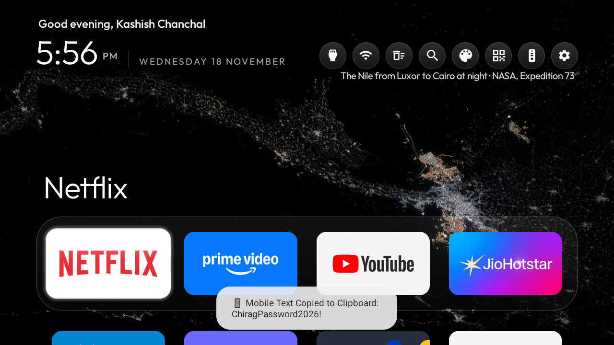

# 🍎 TrimOS

<div align="center">


### **L'ambiente operativo ultra-pulito e senza pubblicità per Android TV e Google TV**
*Trasforma qualsiasi Smart TV lenta e satura di pubblicità in un'esperienza scattante ispirata ad Apple TV.*

[](LICENSE)
[](https://android.com/tv)
[](#)
[](#)
[](#)

[English](README.md) • [Deutsch](README.de.md) • [Español](README.es.md) • [Français](README.fr.md) • [Italiano](README.it.md) • [Português (Brasil)](README.pt-BR.md) • [Nederlands](README.nl.md) • [Türkçe](README.tr.md) • [Ελληνικά](README.el.md) • [עברית](README.he.md) • [Українська](README.uk.md) • [Oʻzbekcha](README.uz.md) • [Tiếng Việt](README.vi.md) • [日本語](README.ja.md) • [简体中文](README.zh-CN.md) • [繁體中文](README.zh-TW.md)

[Funzionalità](#-perch%C3%A9-trimos) • [Screenshot](#-galleria-visiva) • [Guida Rapida](#-guida-rapida) • [TV Compatibili](#-tv-supportate-e-profili-produttore) • [Telecomando Mobile](#-accesso-da-smartphone-e-touchpad-virtuale) • [Ripristino](#-%EF%B8%8F-sicurezza-e-ripristino-in-1-clic)

</div>

---

## ⚡ Perché TrimOS?

I televisori smart attuali sono appesantiti da annunci video a tutto schermo, trailer in riproduzione automatica, caroselli sponsorizzati e processi di telemetria invasivi che occupano fino all'80% della memoria RAM disponibile.

**TrimOS** sostituisce interamente le interfacce gonfie dei produttori (Xiaomi PatchWall, consigli sponsorizzati Google TV, banner Fire TV, ecc.) con un ambiente fluido, veloce e privo di distrazioni ispirato ad Apple TV:

| Funzionalità | Smart TV di Fabbrica | TrimOS |
| :--- | :---: | :---: |
| **Pubblicità e Video in Autoplay** | ❌ Invadenti ovunque | 🟢 **100% Senza Pubblicità** |
| **Consumo di RAM** | ❌ 600 MB – 1.2 GB | 🟢 **~22 MB (Ultra-leggero)** |
| **Fluidità di Navigazione** | ❌ Lenta e a scatti | 🟢 **UI fluida a 60 fps** |
| **YouTube Senza Annunci** | ❌ Interruzioni continue | 🟢 **SmartTube con SponsorBlock** |
| **Digitazione Password** | ❌ Estenuante con il telecomando | 🟢 **Scansione QR e digitazione da smartphone** |
| **Mouse Virtuale / Touchpad** | ❌ Assente | 🟢 **Trackpad completo con Drag & Drop** |
| **Personalizzazione Temi** | ❌ 1 sola interfaccia del produttore | 🟢 **32 Temi inclusi** |
| **Ricerca Streaming Universale** | ❌ Limitata a servizi sponsorizzati | 🟢 **Ricerca unificata multipiattaforma** |
| **Rimappatura Tasti Telecomando** | ❌ Tasti pubblicitari bloccati | 🟢 **Telecomando completamente rimappabile** |
| **Root Richiesto** | ⚠️ Rischioso e complesso | 🟢 **Nessun Root (ADB sicuro)** |

---

## 📸 Galleria Visiva

### 1. Interfaccia Stile Apple TV e Saluti Personalizzati
> Schermata principale reattiva con viste aeree satellitari 4K della NASA, animazioni delicate e messaggi di benvenuto dinamici per tutta la famiglia.
<div align="center">
  
</div>

---

### 2. 📱 Telecomando Mobile e Touchpad Virtuale con Trascinamento
> Apri il codice QR o naviga su `http://<ip-tv>:8080` da qualsiasi smartphone collegato al Wi-Fi. Muovi un puntatore fluido, tocca per fare clic, tieni premuto per trascinare gli elementi e usa i pulsanti di scorrimento dedicati.
<div align="center">
  
</div>

---

### 3. 📺 Integrazione SmartTube Senza Pubblicità
> SmartTube preconfigurato con SponsorBlock automatico (salta promozioni, intro e interruzioni sponsorizzate) e riproduzione 4K fluida.
<div align="center">
  
</div>

---

### 4. 🎨 32 Temi Integrati (Selettore a Schermo)
> Passa all'istante tra 32 design diversi direttamente sul televisore o dal telefono: **Aerial**, **Minimal (Nero Puro OLED)**, **Midnight Glass**, **Aurora Boreale**, **Cinema**, **Retro Anni '80**, **Temi Festivi** e molto altro.
<div align="center">
  
</div>

---

### 5. 🔍 Ricerca Streaming Universale
> Cerca contemporaneamente in Netflix, SmartTube, Amazon Prime Video e Disney+ per titolo, attore o genere.
<div align="center">
  
</div>

---

### 6. 📱 Accesso Rapido tramite Codice QR
> Non inserire mai più lunghe password con le frecce del telecomando. Inquadra il codice QR e usa la tastiera o il gestore password dello smartphone per incollare il testo direttamente sul televisore.
<div align="center">
  
</div>

---

### 7. 🎛️ Rimappatore Tasti Telecomando
> Riassegna i tasti colorati (Rosso/Verde/Giallo/Blu), Menu, Indietro o i tasti numerici per avviare il Pulitore RAM, la Ricerca Universale, il Cambio Tema o le tue app preferite.
<div align="center">
  
</div>

---

### 8. 🧹 Pulizia RAM e Ottimizzazione in 1 Clic
> Libera memoria RAM istantaneamente con un solo clic. Chiude in sicurezza i processi memorizzati nella cache e mostra i megabyte recuperati.
<div align="center">
  
</div>

---

### 9. 🌌 Screensaver Aereo Stile Apple TV
> Screensaver dinamico con spettacolari immagini aeree satellitari della Terra della NASA, alone luminoso e un orologio dal design raffinato.
<div align="center">
  
</div>

---

## 🚀 Guida Rapida

### Prerequisiti
1. **Abilitare Opzioni Sviluppatore e Debug ADB sul televisore**:
   - Vai nelle **Impostazioni** della TV → **Preferenze dispositivo** → **Informazioni**.
   - Premi ripetutamente 7 volte su **Build / Numero build** finché non appare *"Ora sei uno sviluppatore!"*.
   - Torna nelle **Opzioni sviluppatore** e attiva **Debug USB** e **Debug di rete / ADB**.
2. Assicurati che computer e televisore siano connessi alla stessa rete Wi-Fi.

---

### Installazione Automatica in 1 Clic (Consigliata)

Clona il repository ed esegui l'installer universale:

```bash
git clone https://github.com/chiragchanchal/TrimOS.git
cd TrimOS
```

#### Su Windows:
```powershell
python trimos.py install --ip <IP_DELLA_TV>
# oppure fai doppio clic su trimos.bat
```

#### Su macOS / Linux:
```bash
python3 trimos.py install --ip <IP_DELLA_TV>
```

*L'installer riconoscerà automaticamente la marca del televisore, installerà l'APK TrimOS, bloccherà il tasto Home, disattiverà in sicurezza i servizi pubblicitari e installerà la versione corretta di SmartTube per la tua architettura hardware.*

---

### Installazione Manuale (Senza Python)

Se hai già `adb` configurato nel terminale:

```bash
# 1. Connetti al televisore
adb connect <IP_DELLA_TV>:5555

# 2. Installa TrimOS
adb install -r -g release/TrimOS-v1.0.apk

# 3. Abilita servizio di accessibilità per tasto Home e Touchpad
adb shell settings put secure enabled_accessibility_services com.gathin.tvhome/.HomeKeyService
adb shell settings put secure accessibility_enabled 1

# 4. (Facoltativo) Installa SmartTube
# Per TV a 32-bit (Mi TV 4A/4C, FireStick, ecc.):
adb install -r release/SmartTube-v32.71-armeabi-v7a.apk
# Per TV a 64-bit (Nvidia Shield, Google TV moderni):
adb install -r release/SmartTube-v32.71-arm64-v8a.apk

# 5. Avvia TrimOS
adb shell am start -n com.gathin.tvhome/.MainActivity
```

---

## 📺 TV Supportate e Profili Produttore

TrimOS include configurazioni personalizzate che gestiscono le peculiarità di ogni grande marchio:

| Marchio / Piattaforma | Modelli Testati | Cosa rimuove e ottimizza TrimOS |
| :--- | :--- | :--- |
| **Xiaomi / Redmi** | Mi TV 4A, 4C, 5X, Serie X, Horizon, Redmi TV | Rimuove PatchWall, video promozionali e canali di raccomandazione. Mantiene porte HDMI e CEC perfettamente attivi. |
| **Google TV** | Chromecast con Google TV (HD/4K), Sony Bravia, TCL | Disattiva le schede promozionali in `launcherx`. Google Cast e Play Store restano operativi. |
| **Android TV Stock** | Sony Bravia, TCL, Hisense, Philips, Sharp, Skyworth | Sostituisce il pesante launcher Leanback. Mantiene attive tutte le impostazioni audio e video proprietarie. |
| **Amazon Fire TV** | Fire TV Stick 4K / Max, Fire TV Cube, Serie Omni | Bypassa la schermata commerciale di Fire OS e aggancia il tasto Home a TrimOS. |
| **OnePlus TV** | OnePlus TV Q1, U1S, Y1S | Elimina OxygenPlay e i servizi promozionali in background. |
| **Box TV Generici** | Nvidia Shield TV, Mecool, Dynalink, Formuler, X96 | Esperienza pura a 60 fps con consumo minimo di risorse. |

---

## 📱 Accesso da Smartphone e Touchpad Virtuale

Ogni TV dotata di TrimOS ospita un server web locale a bassissima latenza raggiungibile senza passare per il cloud:

1. Premi l'**icona QR** nella barra superiore della TV (o apri `http://<ip-tv>:8080` nel browser del telefono).
2. **Touchpad Virtuale**:
   - **Trascina il dito**: Muovi il cursore sullo schermo del televisore.
   - **Tocca**: Clic.
   - **Modalità Trascina**: Attiva **Drag Mode: ON** per selezionare o trascinare.
   - **Pulsanti Scroll**: Scorri in alto e in basso agilmente.
3. **Digitazione da Smartphone**:
   - Inserisci testi lunghi o incolla URL dallo smartphone e tocca **"Send to TV Keyboard / Clipboard"**.
4. **Scelta Rapida Temi**:
   - Modifica il tema grafico direttamente dal menu a tendina sul telefono.

---

## 🛡️ Sicurezza e Ripristino in 1 Clic

TrimOS è **totalmente non distruttivo**:
- La rimozione dei pacchetti indesiderati avviene tramite `pm uninstall -k --user 0 <pacchetto>`, disabilitandoli solo per l'utente primario e preservando intatta la partizione di sistema.
- Nessun file di sistema viene cancellato e non serve il Root.

Per tornare al launcher di fabbrica in qualsiasi istante:

```bash
python trimos.py restore --ip <IP_DELLA_TV>
```

Questa procedura ripristinerà immediatamente il launcher originale (PatchWall, Google TV, ecc.).

---

## 🛠️ Comandi CLI e Utilità

Lo strumento `trimos.py` racchiude tutti i comandi di gestione utili:

```bash
# Verifica stato di connessione, app in primo piano e memoria
python trimos.py status --ip 192.168.1.9

# Esegui pulizia della memoria RAM da remoto
python trimos.py clean --ip 192.168.1.9

# Cambia tema da remoto
python trimos.py theme --theme-name aurora --ip 192.168.1.9

# Cattura uno screenshot della TV sul computer
python trimos.py screenshot --ip 192.168.1.9

# Apri il telecomando web nel browser del PC
python trimos.py remote --ip 192.168.1.9
```

---

## 📁 Struttura del Repository

```
TrimOS/
├── release/                      # File APK pronti per l'installazione
│   ├── TrimOS-v1.0.apk           # APK del launcher TrimOS compilato
│   ├── SmartTube-v32.71-armeabi-v7a.apk  # SmartTube 32-bit senza pubblicità
│   └── SmartTube-v32.71-arm64-v8a.apk    # SmartTube 64-bit senza pubblicità
├── docs/
│   └── screenshots/              # Screenshot reali catturati su TV
├── launcher/                     # Codice sorgente Android Studio completo
│   └── app/src/main/
│       ├── java/com/gathin/tvhome/
│       │   ├── MainActivity.java         # Interfaccia stile Apple TV e gestione focus
│       │   ├── HomeKeyService.java       # Servizio di accessibilità per tasto Home
│       │   ├── BootReceiver.java         # Riavvio automatico all'accensione
│       │   ├── MouseController.java      # Puntatore mouse virtuale e trascinamento
│       │   ├── TvHttpServer.java         # Server web locale per telecomando e input
│       │   ├── ThemeManager.java         # Gestore risorse dei 32 temi
│       │   ├── UniversalSearchHelper.java# Ricerca streaming unificata
│       │   ├── RemoteRemapHelper.java    # Gestione rimappatura tasti
│       │   └── QrCodeHelper.java         # Generatore codice QR locale
│       └── assets/themes/                # 32 temi e sfondi integrati
├── trimos.py                     # Installer e strumento da riga di comando
├── trimos.bat                    # Script di avvio per Windows in 1 clic
├── trimos.sh                     # Script di avvio per Linux / macOS
├── LICENSE                       # Licenza MIT
└── README.md                     # Documentazione principale in lingua inglese
```

---

## 📜 Licenza

Questo progetto è rilasciato sotto la **Licenza MIT** – vedi il file [LICENSE](LICENSE) per tutti i dettagli.

---

<div align="center">
  <b>Creato per un'esperienza TV scattante, pulita e libera da qualsiasi pubblicità.</b><br>
  <sub>Se TrimOS ha migliorato il tuo televisore, lascia una ⭐️ su GitHub!</sub>
</div>
