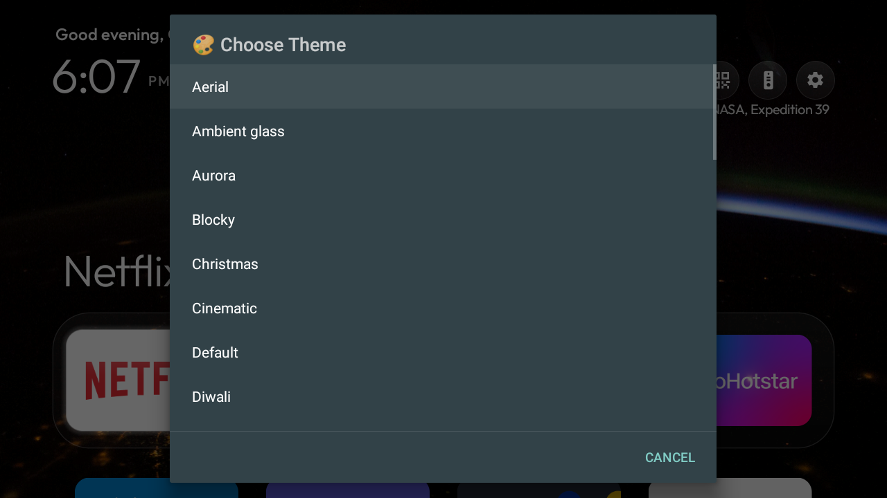

# 🍎 TrimOS

<div align="center">


### **The Ultra-Clean, Ad-Free Operating Environment for Android TV & Google TV**
*Transform any sluggish, ad-bloated smart TV into a lightning-fast, Apple TV-inspired experience.*

[](LICENSE)
[](https://android.com/tv)
[](#)
[](#)
[](#)

[English](README.md) • [Deutsch](README.de.md) • [Español](README.es.md) • [Français](README.fr.md) • [Italiano](README.it.md) • [Português (Brasil)](README.pt-BR.md) • [Nederlands](README.nl.md) • [Türkçe](README.tr.md) • [Ελληνικά](README.el.md) • [עברית](README.he.md) • [Українська](README.uk.md) • [Oʻzbekcha](README.uz.md) • [Tiếng Việt](README.vi.md) • [日本語](README.ja.md) • [简体中文](README.zh-CN.md) • [繁體中文](README.zh-TW.md)

[Features](#-why-trimos) • [Screenshots](#-visual-showcase) • [Quick Start](#-quick-start) • [Supported TVs](#-supported-tvs--profiles) • [Mobile Remote](#-mobile-sign-in--touchpad-remote) • [Restore](#-safety--1-click-restore)

</div>

---

## ⚡ Why TrimOS?

Smart TVs today are plagued by intrusive full-screen video ads, autoplay promotions, sponsored carousels, and aggressive telemetry services that consume up to 80% of your TV's scarce RAM.

**TrimOS** completely replaces OEM bloatware (Xiaomi PatchWall, Google TV recommendations, Fire TV sponsored bars, etc.) with a pure, high-performance, distraction-free environment inspired by Apple TV:

| Feature | Factory Smart TV | TrimOS |
| :--- | :---: | :---: |
| **Ads & Autoplay Videos** | ❌ Persistent Everywhere | 🟢 **100% Ad-Free** |
| **RAM Consumption** | ❌ 600 MB – 1.2 GB | 🟢 **~22 MB (Ultra-Lightweight)** |
| **Boot & Navigation Lag** | ❌ Stuttery & Slow | 🟢 **Instant 60fps Fluid UI** |
| **Ad-Free YouTube** | ❌ Constant 30s Ads | 🟢 **SmartTube with SponsorBlock** |
| **Typing Passwords** | ❌ Painful Remote D-pad | 🟢 **Scan QR & Type on Phone** |
| **Virtual Mouse / Touchpad** | ❌ None | 🟢 **Full Trackpad with Drag & Drop** |
| **Theme Customization** | ❌ 1 Fixed Vendor Skin | 🟢 **32 Built-In Themes** |
| **Universal Streaming Search** | ❌ Biased Vendor Search | 🟢 **Unified Cross-App Search** |
| **Remote Button Remapping** | ❌ Hardcoded Sponsor Keys | 🟢 **Fully Remappable Remote** |
| **Root Required** | ⚠️ Risky & Complex | 🟢 **No Root Needed (Safe ADB)** |

---

## 📸 Visual Showcase

### 1. Apple TV Interface & Dynamic Personal Greetings
> Clean, fluid home screen with live 4K NASA satellite aerial backdrops, smooth tile elevation, and dynamic greeting message that cycles per family member (*Chirag Chanchal, Kashish Chanchal, Girish Narayan, Kamini Chanchal*).
<div align="center">
  
</div>

---

### 2. 📱 Mobile Remote & Virtual Mouse Trackpad with Dragging
> Open the QR code or browse to `http://<tv-ip>:8080` from any smartphone on Wi-Fi. Control a smooth floating mouse pointer, tap to click, hold to drag cards or progress bars, and use dedicated scroll controls.
<div align="center">
  
</div>

---

### 3. 📺 Ad-Free SmartTube Integration
> Pre-configured SmartTube integration with automatic SponsorBlock (skips sponsor plugs, intros, and reminders) and high-bitrate 4K playback.
<div align="center">
  
</div>

---

### 4. 🎨 32 Built-In Themes (On-Device Switcher)
> Instant switching between 32 themes right on your TV or phone: **Aerial**, **Minimal (OLED Pure Black)**, **Midnight Glass**, **Aurora Borealis**, **Cinematic Theatre**, **Retro 80s Synthwave**, **Diwali & Dussehra Festive**, and more.
<div align="center">
  
</div>

---

### 5. 🔍 Universal Streaming Search
> Search once across Netflix, SmartTube, Amazon Prime Video, and Disney+ Hotstar by title, actor, or genre.
<div align="center">
  
</div>

---

### 6. 📱 QR Code & Mobile Sign-In
> Never type passwords with a TV remote again. Scan the on-screen QR code and use your phone's native keyboard or password manager to instantly autofill passwords and URLs directly to the TV clipboard.
<div align="center">
  
</div>

---

### 7. 🎛️ Remote Button Remapper
> Remap color keys (Red/Green/Yellow/Blue), Menu, Back, or number buttons to instantly launch RAM Cleaner, Universal Search, Theme Switcher, or favorite streaming apps.
<div align="center">
  
</div>

---

### 8. 🧹 1-Click RAM Cleaner & Optimization
> Free up TV memory instantly with a single click. Safely terminates background cached apps and displays reclaimed memory in MB.
<div align="center">
  
</div>

---

### 9. 🌌 Apple TV Style Aerial Screensaver
> Dynamic screensaver featuring high-resolution NASA Earth aerial photography, animated orbital glow, and a sleek typography clock.
<div align="center">
  
</div>

---

## 🚀 Quick Start

### Prerequisites
1. **Enable Developer Options & ADB Debugging on your TV**:
   - Go to TV **Settings** → **Device Preferences** → **About**.
   - Tap **Build** 7 times until you see *"You are now a developer!"*.
   - Go back to **Developer Options** and enable **USB Debugging** and **Network / ADB Debugging**.
2. Make sure your computer and TV are connected to the same Wi-Fi network.

---

### 1-Click Automated Installation (Recommended)

Clone the repository and run the universal installer:

```bash
git clone https://github.com/YOUR_USERNAME/TrimOS.git
cd TrimOS
```

#### On Windows:
```powershell
python trimos.py install --ip <YOUR_TV_IP>
# or simply double-click trimos.bat
```

#### On macOS / Linux:
```bash
python3 trimos.py install --ip <YOUR_TV_IP>
```

*The installer will automatically detect your TV's brand, install the launcher APK, enable permanent Home button protection, debloat stock recommendation services safely, and install ad-free SmartTube matching your TV's architecture.*

---

### Manual Installation (No Python Required)

If you already have `adb` installed:

```bash
# 1. Connect to TV
adb connect <YOUR_TV_IP>:5555

# 2. Install TrimOS
adb install -r -g release/TrimOS-v1.0.apk

# 3. Enable System-Wide Home Key & Touchpad Service
adb shell settings put secure enabled_accessibility_services com.gathin.tvhome/.HomeKeyService
adb shell settings put secure accessibility_enabled 1

# 4. (Optional) Install SmartTube
# For 32-bit TVs (Mi TV 4A/4C, FireStick, etc.):
adb install -r release/SmartTube-v32.71-armeabi-v7a.apk
# For 64-bit TVs (Shield TV, modern Google TVs):
adb install -r release/SmartTube-v32.71-arm64-v8a.apk

# 5. Launch TrimOS
adb shell am start -n com.gathin.tvhome/.MainActivity
```

---

## 📺 Supported TVs & Profiles

TrimOS includes dedicated vendor profiles that understand the exact package names and power quirks of every major TV brand:

| Brand / Platform | Tested Devices | What TrimOS Cleans & Optimizes |
| :--- | :--- | :--- |
| **Xiaomi / Redmi** | Mi TV 4A, 4C, 5X, X-Series, Horizon, Redmi TV | Safely uninstalls PatchWall launcher, autoplay video banner ads, and recommendation push channels. Keeps TV inputs & CEC intact. |
| **Google TV** | Chromecast with Google TV (HD/4K), Sony Bravia Google TV, TCL Google TV | Safely disables Google TV `launcherx` ad banner carousels and sponsored app rows. Core Google Cast & Play Store remain intact. |
| **Android TV Stock** | Sony Bravia, TCL, Hisense, Philips, Sharp, Skyworth | Replaces Leanback launcher and recommendation carousels. Picture and audio modes remain fully functional. |
| **Amazon Fire TV** | Fire TV Stick 4K / Max, Fire TV Cube, Omni Series | Bypasses Fire OS home ad grid and maps Home button directly to TrimOS. |
| **OnePlus TV** | OnePlus TV Q1, U1S, Y1S | Safely debloats OxygenPlay and vendor recommendation daemons. |
| **Generic TV Boxes** | Nvidia Shield TV, Mecool, Dynalink, Formuler, X96 | Pure 60fps launcher experience with minimal RAM footprint. |

---

## 📱 Mobile Sign-In & Touchpad Remote

Every TrimOS TV runs a local, zero-cloud web controller accessible directly on your home network:

1. Click the **QR icon** in the top bar on your TV (or open `http://<tv-ip>:8080` in your phone browser).
2. **Virtual Touchpad**:
   - **Swipe finger**: Move the blue cursor smoothly across the TV.
   - **Tap**: Click.
   - **Drag Toggle**: Tap **Drag Mode: ON** to click-and-drag across the screen.
   - **Scroll Buttons**: Instant Scroll Up & Scroll Down.
3. **Mobile Sign-In**:
   - Type long passwords or paste URLs on your phone, then tap **"Send to TV Keyboard / Clipboard"**.
4. **Instant Theme Switcher**:
   - Change your TV theme directly from the dropdown on your phone.

---

## 🛡️ Safety & 1-Click Restore

TrimOS is **100% non-destructive**:
- Debloating is done using `pm uninstall -k --user 0 <package>`, which removes the bloatware only from the active user space while keeping the factory firmware untouched.
- No system files are deleted, and no root is required.

To revert back to your factory stock launcher at any time:

```bash
python trimos.py restore --ip <YOUR_TV_IP>
```

This will immediately re-enable your factory OEM launcher (PatchWall, Google TV, etc.) and restore your original home screen.

---

## 🛠️ CLI Commands & Utilities

The included `trimos.py` tool serves as an all-in-one TV management utility:

```bash
# Check TV connection, top activity & memory usage
python trimos.py status --ip 192.168.1.9

# Trigger RAM clean remotely
python trimos.py clean --ip 192.168.1.9

# Switch theme remotely
python trimos.py theme --theme-name aurora --ip 192.168.1.9

# Capture a high-res screenshot from the TV to your PC
python trimos.py screenshot --ip 192.168.1.9

# Open the Web Remote in your computer browser
python trimos.py remote --ip 192.168.1.9
```

---

## 📁 Repository Structure

```
TrimOS/
├── release/                      # Ready-to-install prebuilt APKs
│   ├── TrimOS-v1.0.apk           # Pre-compiled TrimOS Launcher APK
│   ├── SmartTube-v32.71-armeabi-v7a.apk  # 32-bit Ad-Free SmartTube
│   └── SmartTube-v32.71-arm64-v8a.apk    # 64-bit Ad-Free SmartTube
├── docs/
│   └── screenshots/              # High-res on-device TV screenshots
├── launcher/                     # Full Android Studio project source code
│   └── app/src/main/
│       ├── java/com/gathin/tvhome/
│       │   ├── MainActivity.java         # Core Apple TV UI & Focus Engine
│       │   ├── HomeKeyService.java       # Accessibility Home Lock & Gesture Dispatcher
│       │   ├── BootReceiver.java         # Reboot persistence receiver
│       │   ├── MouseController.java      # Floating cursor & drag engine
│       │   ├── TvHttpServer.java         # Built-in Web Remote & Sign-In server
│       │   ├── ThemeManager.java         # 32-theme asset manager
│       │   ├── UniversalSearchHelper.java# Multi-app streaming search
│       │   ├── RemoteRemapHelper.java    # Remote button remapping
│       │   └── QrCodeHelper.java         # ZXing QR code generator
│       └── assets/themes/                # 32 bundled themes & wallpapers
├── trimos.py                     # Universal TV installer & CLI tool
├── trimos.bat                    # Windows 1-click launcher
├── trimos.sh                     # Linux / macOS 1-click launcher
├── LICENSE                       # MIT License
└── README.md                     # You are here!
```

---

## 📜 License

This project is licensed under the **MIT License** - see the [LICENSE](LICENSE) file for details.

---

<div align="center">
  <b>Built for a faster, cleaner, and ad-free TV experience.</b><br>
  <sub>If TrimOS made your TV feel like an Apple TV, leave a ⭐️ on GitHub!</sub>
</div>
