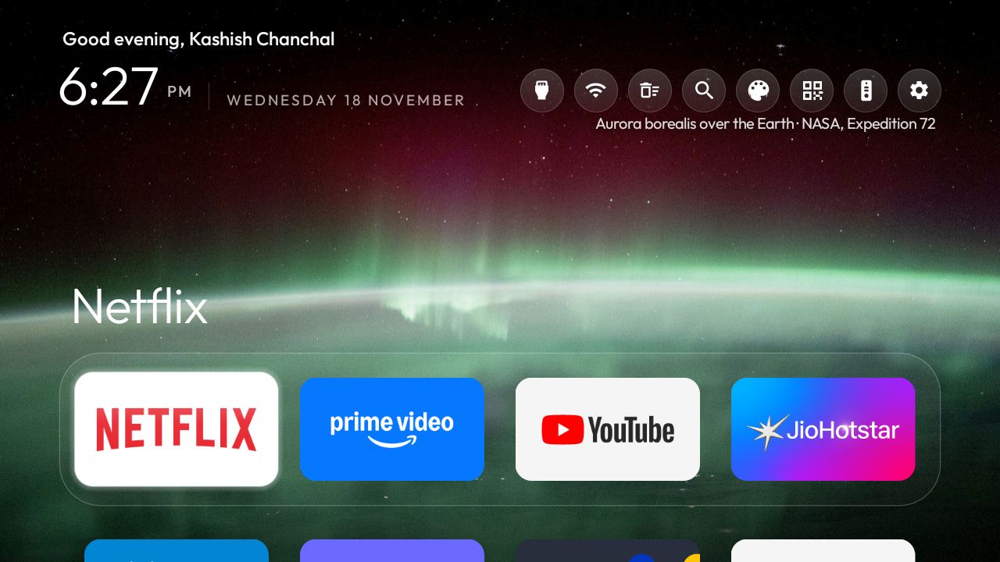

# 🍎 TrimOS

<div align="center">



### **De ultra-schone, advertentievrije besturingsomgeving voor Android TV & Google TV**
*Transformeer elke trage, met advertenties overladen smart-tv in een razendsnelle ervaring geïnspireerd op Apple TV.*

[](LICENSE)
[](https://android.com/tv)
[](#)
[](#)
[](#)

[English](README.md) • [Deutsch](README.de.md) • [Español](README.es.md) • [Français](README.fr.md) • [Italiano](README.it.md) • [Português (Brasil)](README.pt-BR.md) • [Nederlands](README.nl.md) • [Türkçe](README.tr.md) • [Ελληνικά](README.el.md) • [עברית](README.he.md) • [Українська](README.uk.md) • [Oʻzbekcha](README.uz.md) • [Tiếng Việt](README.vi.md) • [日本語](README.ja.md) • [简体中文](README.zh-CN.md) • [繁體中文](README.zh-TW.md)

[Functies](#-waarom-trimos) • [Schermafbeeldingen](#-visueel-overzicht) • [Snelstart](#-snelle-start) • [Ondersteunde TV's](#-ondersteunde-tvs--profielen) • [Mobiele Afstandsbediening](#-mobiel-inloggen--virtuele-touchpad-afstandsbediening) • [Herstel](#-%EF%B8%8F-veiligheid--herstel-in-1-klik)

</div>

---

## ⚡ Waarom TrimOS?

Hedendaagse smart-tv's worden overspoeld met opdringerige paginagrote videoreclames, automatische trailers, gesponsorde rijen en intensieve telemetriediensten die tot 80% van het schaarse RAM-geheugen van uw tv in beslag nemen.

**TrimOS** vervangt de trage fabriekssoftware (Xiaomi PatchWall, Google TV aanbevelingen, Fire TV reclamebalken, enz.) volledig door een schone, hoogwaardige en rustige omgeving geïnspireerd op Apple TV:

| Functie | Fabrieks Smart TV | TrimOS |
| :--- | :---: | :---: |
| **Advertenties & Autoplay Video's** | ❌ Altijd en overal aanwezig | 🟢 **100% Advertentievrij** |
| **RAM-Geheugengebruik** | ❌ 600 MB – 1,2 GB | 🟢 **~22 MB (Extreem lichtgewicht)** |
| **Opstart- en Navigatievertraging** | ❌ Haperend en traag | 🟢 **Vloeiende 60 fps bediening** |
| **Reclamevrije YouTube** | ❌ Voortdurende onderbrekingen | 🟢 **SmartTube met SponsorBlock** |
| **Wachtwoorden Invoeren** | ❌ Moeizaam met de afstandsbediening | 🟢 **Scan QR-code & typ op uw telefoon** |
| **Virtuele Muis / Touchpad** | ❌ Niet aanwezig | 🟢 **Volledig trackpad met slepen en neerzetten** |
| **Thema's Aanpassen** | ❌ 1 vaste fabrieksweergave | 🟢 **32 Geïntegreerde Thema's** |
| **Universele Streaming Zoekfunctie** | ❌ Beperkt tot gesponsorde diensten | 🟢 **Gecombineerd zoeken over meerdere apps** |
| **Knoppen Herprogrammeren** | ❌ Vastgelegde commerciële knoppen | 🟢 **Volledig aanpasbare afstandsbediening** |
| **Root Vereist** | ⚠️ Risicovol en ingewikkeld | 🟢 **Geen Root nodig (Veilige ADB)** |

---

## 📸 Visueel Overzicht

### 1. Apple TV Interface & Persoonlijke Begroetingen
> Schoon en soepel beginscherm met echte 4K NASA-satellietbeelden, vloeiende tegelanimaties en wisselende begroetingen voor alle gezinsleden.
<div align="center">
  
</div>

---

### 2. 📱 Mobiele Afstandsbediening & Virtueel Touchpad met Slepen
> Open de QR-code of ga op uw telefoon naar `http://<tv-ip>:8080`. Bestuur een soepele muisaanwijzer, tik om te klikken, houd ingedrukt om elementen te verslepen en gebruik speciale scrollknoppen.
<div align="center">
  
</div>

---

### 3. 📺 Reclamevrije SmartTube Integratie
> Vooraf geconfigureerde SmartTube-integratie met automatische SponsorBlock (slaat advertenties, intro's en sponsorvermeldingen over) en kristalheldere 4K-weergave.
<div align="center">
  
</div>

---

### 4. 🎨 32 Ingebouwde Thema's (Wisselen op het Scherm)
> Wissel direct tussen 32 designs op uw tv of smartphone: **Aerial**, **Minimal (Zuiver OLED Zwart)**, **Midnight Glass**, **Noorderlicht**, **Bioscoop**, **Retro Jaren 80 Synthwave**, **Feestdagen** en meer.
<div align="center">
  
</div>

---

### 5. 🔍 Universele Streaming Zoekfunctie
> Zoek in één handeling gelijktijdig in Netflix, SmartTube, Amazon Prime Video en Disney+ op titel, acteur of genre.
<div align="center">
  
</div>

---

### 6. 📱 QR-Code & Mobiel Inloggen
> Voer nooit meer moeizaam lange wachtwoorden in met de afstandsbediening. Scan de QR-code op het scherm en gebruik het toetsenbord of de wachtwoordmanager van uw telefoon om direct tekst op de tv te plakken.
<div align="center">
  
</div>

---

### 7. 🎛️ Afstandsbediening Knoppen Herprogrammeren
> Wijs kleurtoetsen (Rood/Groen/Geel/Blauw), Menu, Terug of nummers toe aan acties zoals de RAM-Schoonmaker, Universele Zoekfunctie, Themawisselaar of favoriete streaming-apps.
<div align="center">
  
</div>

---

### 8. 🧹 1-Klik RAM-Schoonmaker & Optimalisatie
> Maak met één klik direct werkgeheugen vrij. Sluit veilig gecachte achtergrondprocessen af en toont de exacte hoeveelheid herwonnen geheugen.
<div align="center">
  
</div>

---

### 9. 🌌 Apple TV Stijl Aerial Schermbeveiliging
> Dynamische schermbeveiliging met hoge-resolutie NASA-luchtfoto's van de aarde, sfeervolle animaties en een strakke klok.
<div align="center">
  
</div>

---

## 🚀 Snelle Start

### Vereisten
1. **Ontwikkelaarsopties & ADB Foutopsporing inschakelen op uw TV**:
   - Ga op uw tv naar **Instellingen** → **Apparaatvoorkeuren** → **Over**.
   - Druk 7 keer op **Build / Build-nummer** tot de melding *"U bent nu een ontwikkelaar!"* verschijnt.
   - Ga terug naar **Opties voor ontwikkelaars** en schakel **USB-foutopsporing** en **Netwerk- / ADB-foutopsporing** in.
2. Zorg ervoor dat uw computer en de tv met hetzelfde wifinetwerk zijn verbonden.

---

### Geautomatiseerde 1-Klik Installatie (Aanbevolen)

Kloon de repository en start het universele installatiescript:

```bash
git clone https://github.com/chiragchanchal/TrimOS.git
cd TrimOS
```

#### Op Windows:
```powershell
python trimos.py install --ip <UW_TV_IP>
# of dubbelklik eenvoudig op trimos.bat
```

#### Op macOS / Linux:
```bash
python3 trimos.py install --ip <UW_TV_IP>
```

*Het script detecteert automatisch het merk van uw televisie, installeert het TrimOS-APK, schakelt permanente Home-knopbescherming in, verwijdert veilig advertentiediensten en installeert de juiste reclamevrije SmartTube voor uw processor.*

---

### Handmatige Installatie (Zonder Python)

Als u `adb` al op uw computer heeft geïnstalleerd:

```bash
# 1. Verbinden met de TV
adb connect <UW_TV_IP>:5555

# 2. TrimOS installeren
adb install -r -g release/TrimOS-v1.0.apk

# 3. Toegankelijkheidsservice voor Home-knop & Touchpad inschakelen
adb shell settings put secure enabled_accessibility_services com.gathin.tvhome/.HomeKeyService
adb shell settings put secure accessibility_enabled 1

# 4. (Optioneel) SmartTube installeren
# Voor 32-bit televisies (Mi TV 4A/4C, FireStick, enz.):
adb install -r release/SmartTube-v32.71-armeabi-v7a.apk
# Voor 64-bit televisies (Shield TV, moderne Google TV's):
adb install -r release/SmartTube-v32.71-arm64-v8a.apk

# 5. TrimOS starten
adb shell am start -n com.gathin.tvhome/.MainActivity
```

---

## 📺 Ondersteunde TV's & Profielen

TrimOS bevat op maat gemaakte leveranciersprofielen voor alle grote smart-tv platformen:

| Merk / Platform | Geteste Apparaten | Wat TrimOS opschoont & optimaliseert |
| :--- | :--- | :--- |
| **Xiaomi / Redmi** | Mi TV 4A, 4C, 5X, X-Serie, Horizon, Redmi TV | Schakelt PatchWall, bannerreclames en aanbevelingskanalen uit. HDMI-ingangen en CEC blijven intact. |
| **Google TV** | Chromecast met Google TV (HD/4K), Sony Bravia, TCL | Schakelt advertentiecarrousels in `launcherx` en gesponsorde rijen uit. Google Cast en Play Store blijven onaangetast. |
| **Standaard Android TV** | Sony Bravia, TCL, Hisense, Philips, Sharp, Skyworth | Vervangt het trage Leanback-startscherm. Beeld- en geluidsinstellingen blijven volledig functioneel. |
| **Amazon Fire TV** | Fire TV Stick 4K / Max, Fire TV Cube, Omni Serie | Omzeilt het drukke Fire OS reclameoverzicht en koppelt de Home-knop direct aan TrimOS. |
| **OnePlus TV** | OnePlus TV Q1, U1S, Y1S | Verwijdert OxygenPlay en achtergrondreclamediensten. |
| **Generieke TV-Boxen** | Nvidia Shield TV, Mecool, Dynalink, Formuler, X96 | Pure 60 fps ervaring met minimaal geheugengebruik. |

---

## 📱 Mobiel Inloggen & Virtuele Touchpad Afstandsbediening

Elke televisie met TrimOS heeft een lokale webserver die bereikbaar is in uw thuisnetwerk zonder tussenkomst van de cloud:

1. Druk op het **QR-icoon** in de bovenbalk van de tv (of open `http://<tv-ip>:8080` in de browser van uw smartphone).
2. **Virtueel Touchpad**:
   - **Vinger bewegen**: Soepele muisbesturing op het scherm.
   - **Tikken**: Klikken.
   - **Sleepmodus**: Zet **Drag Mode: ON** aan om items te verslepen.
   - **Scrollknoppen**: Snel op en neer bladeren in menu's.
3. **Mobiel Inloggen**:
   - Typ lange wachtwoorden op uw telefoon en kies **"Send to TV Keyboard / Clipboard"**.
4. **Directe Themawisselaar**:
   - Pas de visuele stijl van uw tv aan via het keuzemenu op uw smartphone.

---

## 🛡️ Veiligheid & Herstel in 1 Klik

TrimOS is **100% veilig en omkeerbaar**:
- Het uitschakelen van ongewenste apps gebeurt via `pm uninstall -k --user 0 <pakket>`, waardoor apps alleen voor de actieve gebruiker worden gedeactiveerd zonder de systeempartitie te beschadigen.
- Er worden geen systeembestanden verwijderd en Root is niet vereist.

Om op elk gewenst moment terug te keren naar de originele fabrieksweergave:

```bash
python trimos.py restore --ip <UW_TV_IP>
```

Hiermee wordt uw fabriekslauncher (PatchWall, Google TV, enz.) onmiddellijk weer ingeschakeld.

---

## 🛠️ CLI-Commando's & Hulpprogramma's

Het meegeleverde hulpprogramma `trimos.py` biedt handige beheerfuncties voor uw televisie:

```bash
# Verbindingsstatus, actieve app en RAM-geheugen controleren
python trimos.py status --ip 192.168.1.9

# Op afstand RAM-geheugen opschonen
python trimos.py clean --ip 192.168.1.9

# Op afstand van thema wisselen
python trimos.py theme --theme-name aurora --ip 192.168.1.9

# Een schermafbeelding van de TV naar uw pc downloaden
python trimos.py screenshot --ip 192.168.1.9

# De web-afstandsbediening openen in uw pc-browser
python trimos.py remote --ip 192.168.1.9
```

---

## 📁 Projectstructuur

```
TrimOS/
├── release/                      # Kant-en-klare APK-installatiebestanden
│   ├── TrimOS-v1.0.apk           # Gecompileerd TrimOS Launcher installatiebestand
│   ├── SmartTube-v32.71-armeabi-v7a.apk  # 32-bit Advertentievrij SmartTube
│   └── SmartTube-v32.71-arm64-v8a.apk    # 64-bit Advertentievrij SmartTube
├── docs/
│   └── screenshots/              # Schermafbeeldingen gemaakt op televisies
├── launcher/                     # Volledige Android Studio broncode
│   └── app/src/main/
│       ├── java/com/gathin/tvhome/
│       │   ├── MainActivity.java         # Apple TV interface & focus-beheer
│       │   ├── HomeKeyService.java       # Toegankelijkheidsservice voor Home-knop
│       │   ├── BootReceiver.java         # Herstart- en opstartbeheer
│       │   ├── MouseController.java      # Muiscursor & sleepfunctionaliteit
│       │   ├── TvHttpServer.java         # Lokale webserver voor afstandsbediening
│       │   ├── ThemeManager.java         # Beheer van de 32 thema's
│       │   ├── UniversalSearchHelper.java# Universeel streaming zoeken
│       │   ├── RemoteRemapHelper.java    # Beheer knoppentoewijzing
│       │   └── QrCodeHelper.java         # QR-code generator
│       └── assets/themes/                # 32 ingebouwde thema's & achtergronden
├── trimos.py                     # Universeel installatie- & beheerprogramma
├── trimos.bat                    # 1-klik starter voor Windows
├── trimos.sh                     # Starter voor Linux / macOS
├── LICENSE                       # MIT-licentie
└── README.md                     # Hoofddocumentatie in het Engels
```

---

## 📜 Licentie

Dit project valt onder de voorwaarden van de **MIT-licentie** – zie het bestand [LICENSE](LICENSE) voor de volledige tekst.

---

<div align="center">
  <b>Ontwikkeld voor een snellere, schonere en reclamevrije tv-ervaring.</b><br>
  <sub>Heeft TrimOS uw kijkervaring verbeterd? Laat een ⭐️ achter op GitHub!</sub>
</div>
