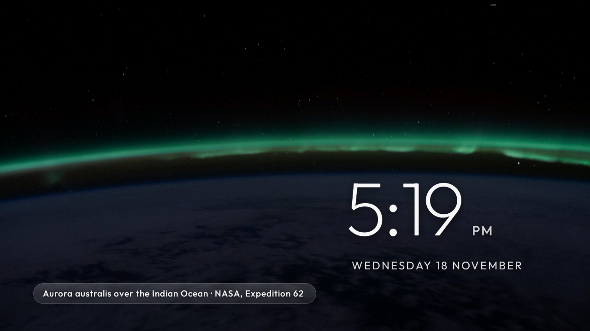

# 🍎 TrimOS

<div align="center">


### **Android TV ve Google TV için Ultra Temiz, Reklamsız İşletim Ortamı**
*Hantal ve reklam dolu her akıllı televizyonu Apple TV esintili, ışık hızında bir deneyime dönüştürün.*

[](LICENSE)
[](https://android.com/tv)
[](#)
[](#)
[](#)

[English](README.md) • [Deutsch](README.de.md) • [Español](README.es.md) • [Français](README.fr.md) • [Italiano](README.it.md) • [Português (Brasil)](README.pt-BR.md) • [Nederlands](README.nl.md) • [Türkçe](README.tr.md) • [Ελληνικά](README.el.md) • [עברית](README.he.md) • [Українська](README.uk.md) • [Oʻzbekcha](README.uz.md) • [Tiếng Việt](README.vi.md) • [日本語](README.ja.md) • [简体中文](README.zh-CN.md) • [繁體中文](README.zh-TW.md)

[Özellikler](#-neden-trimos) • [Ekran Görüntüleri](#-g%C3%B6rsel-galeri) • [Hızlı Başlangıç](#-h%C4%B1zl%C4%B1-ba%C5%9Flang%C4%B1%C3%A7) • [Desteklenen TV'ler](#-desteklenen-tvler--profiller) • [Mobil Kumanda](#-mobil-giri%C5%9F--dokunmatik-fare-kumandas%C4%B1) • [Geri Yükleme](#-%EF%B8%8F-g%C3%BCvenlik--tek-t%C4%B1kla-geri-y%C3%BCkleme)

</div>

---

## ⚡ Neden TrimOS?

Günümüz akıllı televizyonları; tam ekran video reklamlar, otomatik başlayan tanıtımlar, sponsorlu öneri şeritleri ve cihazınızın kısıtlı belleğinin (RAM) %80'ine kadarını tüketen arka plan telemetri servisleriyle doludur.

**TrimOS**, üreticilerin ağır ve yavaş arayüzlerini (Xiaomi PatchWall, Google TV reklamları, Fire TV sponsorlu panelleri vb.) Apple TV sadeliğinde, yüksek performanslı ve tamamen dikkat dağıtmayan bir ortamla değiştirir:

| Özellik | Fabrika Çıkışı Smart TV | TrimOS |
| :--- | :---: | :---: |
| **Reklamlar ve Otomatik Videolar** | ❌ Her köşede rahatsız edici | 🟢 **%100 Reklamsız** |
| **RAM Bellek Tüketimi** | ❌ 600 MB – 1.2 GB | 🟢 **~22 MB (Son derece hafif)** |
| **Açılış ve Menü Gecikmesi** | ❌ Takılan ve yavaş arayüz | 🟢 **Akıcı 60 FPS deneyimi** |
| **Reklamsız YouTube** | ❌ Sürekli 30 saniyelik reklamlar | 🟢 **SponsorBlock destekli SmartTube** |
| **Şifre Yazma Zahmeti** | ❌ Kumandayla tek tek harf seçme | 🟢 **QR okutarak telefondan hızlı yazma** |
| **Sanal Fare / Dokunmatik Yüzey** | ❌ Yok | 🟢 **Sürükle-bırak destekli tam touchpad** |
| **Tema Özelleştirme** | ❌ Üreticinin sabit arayüzü | 🟢 **32 Dahili Tema** |
| **Evrensel Dizi/Film Araması** | ❌ Sponsor odaklı arama | 🟢 **Tüm platformlarda tek aramada sonuç** |
| **Kumanda Tuşlarını Değiştirme** | ❌ Kilitli sponsor tuşları | 🟢 **Tamamen yeniden atanabilir tuşlar** |
| **Root Gerekir mi?** | ⚠️ Riskli ve karmaşık | 🟢 **Root gerekmez (Güvenli ADB)** |

---

## 📸 Görsel Galeri

### 1. Apple TV Arayüzü ve Kişiselleştirilmiş Selamlama
> NASA'nın 4K uydu hava görüntüleri, akıcı kart animasyonları ve aile fertlerine özel selamlama mesajları içeren tertemiz bir ana ekran.
<div align="center">
  
</div>

---

### 2. 📱 Mobil Kumanda ve Sürükleme Destekli Dokunmatik Fare
> Televizyon ekranındaki QR kodunu tarayın veya Wi-Fi üzerinden `http://<tv-ip>:8080` adresine gidin. Ekranda farenizi pürüzsüzce hareket ettirin, tıklayın, kartları sürükleyin ve kaydırma tuşlarını kullanın.
<div align="center">
  
</div>

---

### 3. 📺 Reklamsız SmartTube Entegrasyonu
> Sponsorlu bölümleri, giriş jeneriklerini ve abone olma hatırlatmalarını otomatik atlayan SponsorBlock özellikli, 4K akıcı SmartTube entegrasyonu.
<div align="center">
  
</div>

---

### 4. 🎨 32 Dahili Tema (Cihaz Üzerinden Kolay Geçiş)
> Doğrudan televizyondan veya telefonunuzdan 32 tema arasında anında geçiş yapın: **Aerial**, **Minimal (OLED Tam Siyah)**, **Midnight Glass**, **Kuzey Işıkları**, **Sinematik**, **80'ler Synthwave**, **Bayram Temaları** ve daha fazlası.
<div align="center">
  
</div>

---

### 5. 🔍 Evrensel Streaming Araması
> Netflix, SmartTube, Amazon Prime Video ve Disney+ üzerinde film, dizi veya oyuncu adına göre tek bir seferde arama yapın.
<div align="center">
  
</div>

---

### 6. 📱 QR Kod ile Hızlı Mobil Giriş
> Televizyonda kumandayla şifre yazma çilesine son verin. QR kodu tarayın, telefonunuzun klavyesini veya şifre yöneticisini kullanarak metinleri doğrudan televizyona yapıştırın.
<div align="center">
  
</div>

---

### 7. 🎛️ Kumanda Tuşlarını Yeniden Atama (Remapper)
> Kumandanızdaki renkli tuşlara (Kırmızı/Yeşil/Sarı/Mavi), Menü, Geri veya numara tuşlarına dilediğiniz eylemi atayın: RAM Temizleyici, Evrensel Arama, Tema Değiştirici veya en sevdiğiniz uygulamalar.
<div align="center">
  
</div>

---

### 8. 🧹 Tek Tıkla RAM Temizleme ve Optimizasyon
> Tek tıkla televizyonun RAM belleğini anında boşaltın. Arka planda gizlice çalışan gereksiz işlemleri güvenle sonlandırır ve kazanılan RAM miktarını ekranda gösterir.
<div align="center">
  
</div>

---

### 9. 🌌 Apple TV Tarzı Hava Görüntülü Ekran Koruyucu
> NASA'nın yüksek çözünürlüklü Dünya çekimlerini, zarif bir ışık halkasını ve şık bir saati bir araya getiren dinamik ekran koruyucu.
<div align="center">
  
</div>

---

## 🚀 Hızlı Başlangıç

### Ön Koşullar
1. **Televizyonunuzda Geliştirici Seçeneklerini ve ADB Hata Ayıklamayı Açın**:
   - TV **Ayarlar** → **Cihaz Tercihleri** → **Hakkında** yolunu izleyin.
   - *"Artık bir geliştiricisiniz!"* yazısını görene kadar **Derleme Numarası / Build** üzerine 7 kez üst üste basın.
   - **Geliştirici Seçenekleri** menüsüne dönerek **USB Hata Ayıklama** ve **Ağ / ADB Hata Ayıklama** ayarlarını aktif edin.
2. Bilgisayarınızın ve televizyonunuzun aynı Wi-Fi ağına bağlı olduğundan emin olun.

---

### Tek Tıkla Otomatik Kurulum (Önerilen)

Projeyi indirin ve evrensel yükleyiciyi çalıştırın:

```bash
git clone https://github.com/chiragchanchal/TrimOS.git
cd TrimOS
```

#### Windows'ta:
```powershell
python trimos.py install --ip <TELEVIZYONUNUZUN_IP_ADRESI>
# veya doğrudan trimos.bat dosyasına çift tıklayın
```

#### macOS / Linux'ta:
```bash
python3 trimos.py install --ip <TELEVIZYONUNUZUN_IP_ADRESI>
```

*Yükleyici televizyonunuzun markasını otomatik algılar, TrimOS uygulamasını yükler, Ana Ekran (Home) tuşunu sabitler, reklam servislerini güvenle devre dışı bırakır ve cihazınıza uygun reklamsız SmartTube uygulamasını kurar.*

---

### Manuel Kurulum (Python Olmadan)

Bilgisayarınızda `adb` aracı zaten kuruluysa:

```bash
# 1. Televizyona bağlanın
adb connect <TELEVIZYONUNUZUN_IP_ADRESI>:5555

# 2. TrimOS'u yükleyin
adb install -r -g release/TrimOS-v1.0.apk

# 3. Home tuşu ve dokunmatik fare erişilebilirlik servisini açın
adb shell settings put secure enabled_accessibility_services com.gathin.tvhome/.HomeKeyService
adb shell settings put secure accessibility_enabled 1

# 4. (İsteğe Bağlı) SmartTube'u kurun
# 32-bit TV'ler için (Mi TV 4A/4C, FireStick vb.):
adb install -r release/SmartTube-v32.71-armeabi-v7a.apk
# 64-bit TV'ler için (Shield TV, modern Google TV'ler):
adb install -r release/SmartTube-v32.71-arm64-v8a.apk

# 5. TrimOS'u başlatın
adb shell am start -n com.gathin.tvhome/.MainActivity
```

---

## 📺 Desteklenen TV'ler & Profiller

TrimOS, önde gelen tüm akıllı televizyon markaları için özel paket yönetimi profilleri barındırır:

| Marka / Platform | Test Edilen Modeller | TrimOS'un Temizledikleri ve İyileştirmeleri |
| :--- | :--- | :--- |
| **Xiaomi / Redmi** | Mi TV 4A, 4C, 5X, X-Serisi, Horizon, Redmi TV | PatchWall, video reklam afişleri ve gereksiz öneri kanallarını kapatır. HDMI ve CEC işlevlerini korur. |
| **Google TV** | Chromecast Google TV (HD/4K), Sony Bravia, TCL | `launcherx` reklam şeritlerini ve sponsorlu satırları kapatır. Google Cast ve Play Store eksiksiz çalışır. |
| **Standart Android TV** | Sony Bravia, TCL, Hisense, Philips, Sharp, Skyworth | Ağır Leanback arayüzünü değiştirir. Görüntü ve ses ayarları menülerine dokunmaz. |
| **Amazon Fire TV** | Fire TV Stick 4K / Max, Fire TV Cube, Omni Serisi | Fire OS'un karmaşık reklam ana sayfasını devre dışı bırakıp Ana Sayfa tuşunu TrimOS'a kilitler. |
| **OnePlus TV** | OnePlus TV Q1, U1S, Y1S | OxygenPlay servislerini ve arka plan öneri araçlarını kaldırır. |
| **Genel Android TV Kutuları** | Nvidia Shield TV, Mecool, Dynalink, Formuler, X96 | Minimum bellek tüketimiyle saf 60 FPS arayüz deneyimi. |

---

## 📱 Mobil Giriş & Dokunmatik Fare Kumandası

TrimOS yüklü her televizyon, yerel ağınızda bulut bağımlılığı olmadan çalışan hafif bir web arayüzüne sahiptir:

1. Televizyonun üst çubuğundaki **QR simgesine** tıklayın (veya telefonunuzun tarayıcısından `http://<tv-ip>:8080` adresine gidin).
2. **Sanal Dokunmatik Fare**:
   - **Parmağınızı Kaydırın**: Ekrandaki fare imlecini rahatça yönetin.
   - **Dokunun**: Tıklama işlemi yapın.
   - **Sürükleme Modu**: **Drag Mode: ON** seçeneğiyle öğeleri sürükleyip bırakın.
   - **Kaydırma Tuşları**: Menülerde kolayca yukarı ve aşağı inin.
3. **Mobil Metin Girişi**:
   - Uzun şifreleri veya linkleri telefonunuzda yazıp **"Send to TV Keyboard / Clipboard"** tuşuna basarak televizyona aktarın.
4. **Hızlı Tema Değiştirici**:
   - Televizyonunuzun temasını telefonunuzdaki açılır listeden anında değiştirin.

---

## 🛡️ Güvenlik & Tek Tıkla Geri Yükleme

TrimOS **tamamen güvenli ve geri döndürülebilirdir**:
- İstenmeyen uygulamalar `pm uninstall -k --user 0 <paket>` komutuyla yalnızca birincil kullanıcı için kaldırılır; sistem yazılımına dokunulmaz.
- Hiçbir sistem dosyası silinmez ve Root gerekmez.

Dilediğiniz an televizyonun orijinal fabrika arayüzüne dönmek için:

```bash
python trimos.py restore --ip <TELEVIZYONUNUZUN_IP_ADRESI>
```

Bu komut fabrika başlatıcınızı (PatchWall, Google TV vb.) anında yeniden aktif edecektir.

---

## 🛠️ CLI Komutları ve Araçlar

Beraberinde gelen `trimos.py` komut satırı aracı pratik yönetim olanakları sunar:

```bash
# Bağlantı durumunu, ön plandaki uygulamayı ve RAM durumunu inceleme
python trimos.py status --ip 192.168.1.9

# Uzaktan RAM temizleme işlemini tetikleme
python trimos.py clean --ip 192.168.1.9

# Uzaktan tema değiştirme
python trimos.py theme --theme-name aurora --ip 192.168.1.9

# Televizyondan bilgisayara anlık ekran görüntüsü alma
python trimos.py screenshot --ip 192.168.1.9

# Web kumandasını bilgisayarınızın tarayıcısında açma
python trimos.py remote --ip 192.168.1.9
```

---

## 📁 Proje Dizin Yapısı

```
TrimOS/
├── release/                      # Kuruluma hazır APK paketleri
│   ├── TrimOS-v1.0.apk           # Derlenmiş TrimOS Launcher APK paketi
│   ├── SmartTube-v32.71-armeabi-v7a.apk  # 32-bit Reklamsız SmartTube
│   └── SmartTube-v32.71-arm64-v8a.apk    # 64-bit Reklamsız SmartTube
├── docs/
│   └── screenshots/              # Televizyon üzerinden alınan gerçek ekran görüntüleri
├── launcher/                     # Eksiksiz Android Studio kaynak kodları
│   └── app/src/main/
│       ├── java/com/gathin/tvhome/
│       │   ├── MainActivity.java         # Apple TV arayüzü ve odak motoru
│       │   ├── HomeKeyService.java       # Ana Ekran tuşu erişilebilirlik servisi
│       │   ├── BootReceiver.java         # Yeniden başlatma kalıcılık dinleyicisi
│       │   ├── MouseController.java      # Yüzen imleç ve sürükleme motoru
│       │   ├── TvHttpServer.java         # Yerel web kumanda ve metin servisi
│       │   ├── ThemeManager.java         # 32 temanın yöneticisi
│       │   ├── UniversalSearchHelper.java# Çoklu platform streaming araması
│       │   ├── RemoteRemapHelper.java    # Tuş atama yönetim modülü
│       │   └── QrCodeHelper.java         # Dahili QR kod üretici
│       └── assets/themes/                # 32 dahili tema ve duvar kağıtları
├── trimos.py                     # Evrensel kurulum ve yönetim aracı
├── trimos.bat                    # Windows için tek tıkla başlatıcı
├── trimos.sh                     # Linux / macOS için başlatıcı
├── LICENSE                       # MIT Lisansı
└── README.md                     # İngilizce ana dokümantasyon
```

---

## 📜 Lisans

Bu proje **MIT Lisansı** altında lisanslanmıştır – detaylar için [LICENSE](LICENSE) dosyasına göz atabilirsiniz.

---

<div align="center">
  <b>Daha hızlı, temiz ve reklamsız bir televizyon deneyimi için tasarlandı.</b><br>
  <sub>TrimOS televizyonunuza canlılık kattıysa, GitHub'da bir ⭐️ bırakmayı unutmayın!</sub>
</div>
