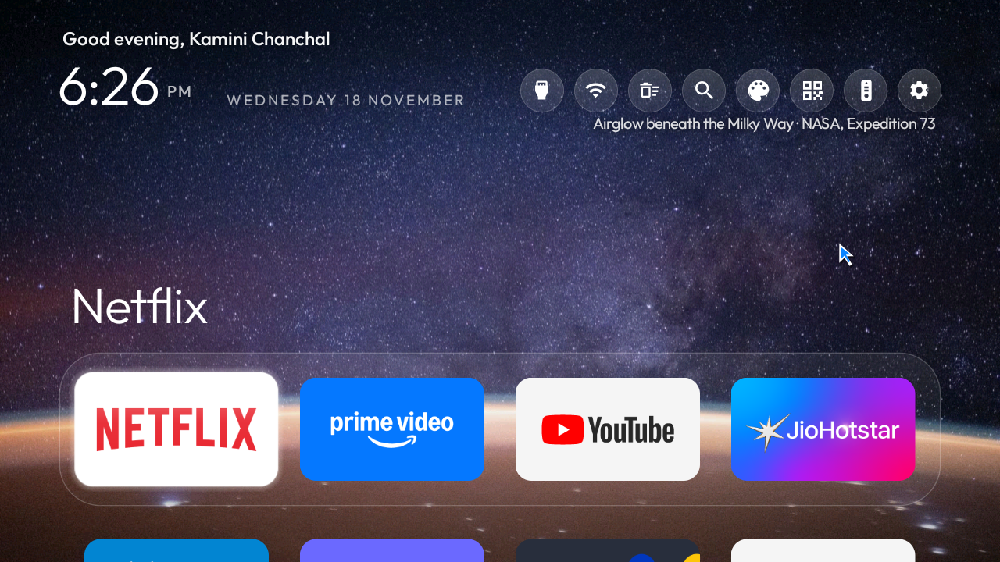
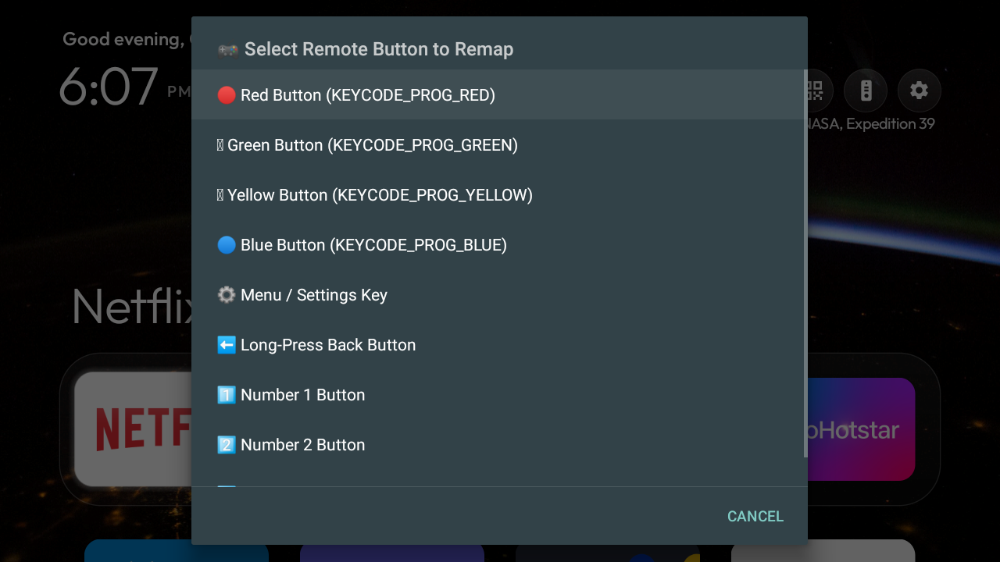

# 🍎 TrimOS

<div align="center">


### **Ультрачисте середовище без реклами для Android TV та Google TV**
*Перетворіть будь-який повільний телевізор із нав'язливою рекламою на блискавичний інтерфейс у стилі Apple TV.*

[](LICENSE)
[](https://android.com/tv)
[](#)
[](#)
[](#)

[English](README.md) • [Deutsch](README.de.md) • [Español](README.es.md) • [Français](README.fr.md) • [Italiano](README.it.md) • [Português (Brasil)](README.pt-BR.md) • [Nederlands](README.nl.md) • [Türkçe](README.tr.md) • [Ελληνικά](README.el.md) • [עברית](README.he.md) • [Українська](README.uk.md) • [Oʻzbekcha](README.uz.md) • [Tiếng Việt](README.vi.md) • [日本語](README.ja.md) • [简体中文](README.zh-CN.md) • [繁體中文](README.zh-TW.md)

[Можливості](#-чому-trimos) • [Скріншоти](#-візуальна-галерея) • [Швидкий старт](#-швидкий-старт) • [Підтримувані TV](#-підтримувані-телевізори-та-профілі) • [Мобільний пульт](#-вхід-зі-смартфона-та-віртуальний-touchpad) • [Відновлення](#-%EF%B8%8F-безпека-та-відновлення-в-1-клік)

</div>

---

## ⚡ Чому TrimOS?

Сучасні телевізори перевантажені повноекранною відеорекламою, автоматичним відтворенням трейлерів, спонсорськими рекомендаціями та важкими службами телеметрії, які споживають до 80% обмеженої оперативної пам'яті вашого ТВ.

**TrimOS** повністю замінює громіздкий заводський софт (Xiaomi PatchWall, банери Google TV, рекламні смуги Fire TV тощо) на чисте, плавне та високопродуктивне середовище, натхненне дизайном Apple TV:

| Функція | Заводський Smart TV | TrimOS |
| :--- | :---: | :---: |
| **Реклама та автовідтворення** | ❌ Постійно та всюди | 🟢 **100% без реклами** |
| **Використання RAM** | ❌ 600 MB – 1.2 GB | 🟢 **~22 MB (Ультралегкий)** |
| **Затримка запуску та анімацій** | ❌ Повільно та ривками | 🟢 **Плавні 60 к/с** |
| **YouTube без реклами** | ❌ Постійні рекламні паузи | 🟢 **SmartTube зі SponsorBlock** |
| **Введення паролів** | ❌ Довго стрілками пульта | 🟢 **Сканування QR та введення з телефону** |
| **Віртуальна миша / Touchpad** | ❌ Відсутня | 🟢 **Повноцінний трекпад із перетягуванням** |
| **Зміна тем оформлення** | ❌ 1 фіксована заводська оболонка | 🟢 **32 вбудовані теми** |
| **Єдиний пошук стрімінгу** | ❌ Тільки партнерські сервіси | 🟢 **Пошук за всіма застосунками одразу** |
| **Перепризначення кнопок** | ❌ Заблоковані рекламні кнопки | 🟢 **Повністю настроюваний пульт** |
| **Потрібен Root** | ⚠️ Ризиковано та складно | 🟢 **Root не потрібен (Безпечний ADB)** |

---

## 📸 Візуальна галерея

### 1. Інтерфейс у стилі Apple TV та персональні привітання
> Лаконічний головний екран зі супутниковими знімками Землі 4K від NASA, плавною анімацією карток та персональними привітаннями для кожного члена родини.
<div align="center">
  
</div>

---

### 2. 📱 Мобільний пульт і віртуальний трекпад із перетягуванням
> Відкрийте QR-код або перейдіть за адресою `http://<ip-телевізора>:8080` у локальній мережі Wi-Fi. Керуйте курсором миші, натискайте, перетягуйте картки та використовуйте зручні кнопки прокручування.
<div align="center">
  
</div>

---

### 3. 📺 Інтеграція SmartTube без реклами
> Попередньо налаштований SmartTube з автоматичним SponsorBlock (пропускає інтегровану рекламу, заставки та заклики підписатися) і стабільним відтворенням 4K.
<div align="center">
  
</div>

---

### 4. 🎨 32 вбудовані теми (Зміна прямо на екрані)
> Миттєвий вибір із 32 стилів оформлення на ТБ або смартфоні: **Aerial**, **Minimal (Глибокий чорний OLED)**, **Midnight Glass**, **Північне сяйво**, **Кінозал**, **Ретро 80-ті Synthwave**, **Святкові теми** тощо.
<div align="center">
  
</div>

---

### 5. 🔍 Єдиний пошук у стрімінгових сервісах
> Шукайте одночасно у Netflix, SmartTube, Amazon Prime Video та Disney+ за назвою, актором чи жанром.
<div align="center">
  
</div>

---

### 6. 📱 QR-код та швидкий вхід зі смартфона
> Забудьте про виснажливе введення паролів пультом. Скануйте QR-код та використовуйте клавіатуру або менеджер паролів телефона для прямої вставки в телевізор.
<div align="center">
  
</div>

---

### 7. 🎛️ Перепризначення кнопок пульта
> Налаштуйте кольорові клавіші (Червона/Зелена/Жовта/Синя), Меню, Назад або цифри на запуск Очищення RAM, Швидкого пошуку, Перемикача тем або улюблених застосунків.
<div align="center">
  
</div>

---

### 8. 🧹 Очищення RAM та оптимізація в 1 клік
> Звільніть оперативну пам'ять телевізора миттєво. Безпечно вивантажує кешовані фонові процеси та виводить кількість повернутої пам'яті.
<div align="center">
  
</div>

---

### 9. 🌌 Аеро-заставка в стилі Apple TV
> Динамічна заставка зі супутниковими панорамами Землі від NASA, витонченим сяйвом та стильним мінімалістичним годинником.
<div align="center">
  
</div>

---

## 🚀 Швидкий старт

### Підготовчі кроки
1. **Увімкніть Параметри розробника та налагодження ADB на ТБ**:
   - Відкрийте на ТВ **Налаштування** → **Параметри пристрою** → **Про пристрій**.
   - Натисніть 7 разів на пункт **Номер складання / Build**, доки не з'явиться *"Ви стали розробником!"*.
   - Поверніться до **Параметрів розробника** та активуйте **Налагодження по USB** і **Налагодження по мережі / ADB**.
2. Переконайтеся, що комп'ютер і телевізор підключені до однієї мережі Wi-Fi.

---

### Автоматичне встановлення в 1 клік (Рекомендовано)

Склонуйте репозиторій та запустіть універсальний інсталятор:

```bash
git clone https://github.com/chiragchanchal/TrimOS.git
cd TrimOS
```

#### На Windows:
```powershell
python trimos.py install --ip <IP_ВАШОГО_ТЕЛЕВІЗОРА>
# або двічі натисніть файл trimos.bat
```

#### На macOS / Linux:
```bash
python3 trimos.py install --ip <IP_ВАШОГО_ТЕЛЕВІЗОРА>
```

*Програма автоматично розпізнає марку ТВ, встановить застосунок TrimOS, захистить кнопку Додому (Home), безпечно відключить рекламу та встановить відповідний SmartTube під архітектуру процесора.*

---

### Встановлення вручну (Без Python)

Якщо у вас на комп'ютері вже налаштовано `adb`:

```bash
# 1. Підключитися до телевізора
adb connect <IP_ВАШОГО_ТЕЛЕВІЗОРА>:5555

# 2. Встановити TrimOS
adb install -r -g release/TrimOS-v1.0.apk

# 3. Активувати службу доступності кнопки Додому та трекпада
adb shell settings put secure enabled_accessibility_services com.gathin.tvhome/.HomeKeyService
adb shell settings put secure accessibility_enabled 1

# 4. (Опційно) Встановити SmartTube
# Для 32-бітних телевізорів (Mi TV 4A/4C, FireStick тощо):
adb install -r release/SmartTube-v32.71-armeabi-v7a.apk
# Для 64-бітних телевізорів (Shield TV, нові Google TV):
adb install -r release/SmartTube-v32.71-arm64-v8a.apk

# 5. Запустити TrimOS
adb shell am start -n com.gathin.tvhome/.MainActivity
```

---

## 📺 Підтримувані телевізори та профілі

TrimOS містить індивідуальні профілі для системного софту всіх провідних брендів:

| Бренд / Платформа | Перевірені моделі | Що TrimOS очищує та покращує |
| :--- | :--- | :--- |
| **Xiaomi / Redmi** | Mi TV 4A, 4C, 5X, Серія X, Horizon, Redmi TV | Вимикає PatchWall, рекламні банери та рекомендаційні канали. Порти HDMI та CEC працюють без змін. |
| **Google TV** | Chromecast з Google TV (HD/4K), Sony Bravia, TCL | Відключає рекламні каруселі `launcherx` та спонсорські рядки. Google Cast і Play Store залишаються активними. |
| **Стандартний Android TV** | Sony Bravia, TCL, Hisense, Philips, Sharp, Skyworth | Замінює важкий Leanback-лаунчер. Всі параметри зображення та звуку залишаються доступними. |
| **Amazon Fire TV** | Fire TV Stick 4K / Max, Fire TV Cube, Серія Omni | Обходить рекламну головну сторінку Fire OS та закріплює кнопку Home за TrimOS. |
| **OnePlus TV** | OnePlus TV Q1, U1S, Y1S | Видаляє служби OxygenPlay та фонові рекламні процеси. |
| **ТВ-бокси Android TV** | Nvidia Shield TV, Mecool, Dynalink, Formuler, X96 | Чисті 60 кадрів на секунду з мінімальним споживанням пам'яті. |

---

## 📱 Вхід зі смартфона та віртуальний Touchpad

Кожен телевізор із TrimOS має вбудований локальний веб-сервер у вашій домашній мережі без хмарної залежності:

1. Натисніть на **іконку QR** на верхній панелі телевізора (або відкрийте `http://<ip-тв>:8080` у браузері телефону).
2. **Віртуальний трекпад**:
   - **Рух пальцем**: Плавне керування вказівником на екрані ТВ.
   - **Дотик**: Клік.
   - **Режим перетягування**: Увімкніть **Drag Mode: ON** для переміщення карток.
   - **Кнопки прокручування**: Швидка навігація вгору та вниз.
3. **Мобільне введення тексту**:
   - Вводьте довгі паролі або посилання на телефоні та тисніть **"Send to TV Keyboard / Clipboard"**.
4. **Миттєвий вибір тем**:
   - Змінюйте вигляд інтерфейсу прямо з меню у смартфоні.

---

## 🛡️ Безпека та відновлення в 1 клік

TrimOS діє **повністю безпечно та безповоротно не змінює прошивку**:
- Вимкнення застосунків здійснюється за допомогою `pm uninstall -k --user 0 <пакет>`, що деактивує їх лише для активного користувача, зберігаючи заводську систему недоторканою.
- Системні файли не видаляються, а Root-права не потрібні.

Щоб повернутися до заводського інтерфейсу в будь-який момент:

```bash
python trimos.py restore --ip <IP_ВАШОГО_ТЕЛЕВІЗОРА>
```

Це одразу відновить стандартний лаунчер (PatchWall, Google TV тощо).

---

## 🛠️ Команди CLI та утиліти

Скрипт `trimos.py` надає зручні засоби керування телевізором:

```bash
# Перевірка з'єднання, активного додатка та використання пам'яті
python trimos.py status --ip 192.168.1.9

# Запуск очищення пам'яті RAM віддалено
python trimos.py clean --ip 192.168.1.9

# Віддалена зміна теми оформлення
python trimos.py theme --theme-name aurora --ip 192.168.1.9

# Збереження знімка екрана телевізора на комп'ютер
python trimos.py screenshot --ip 192.168.1.9

# Відкриття мобільного пульта у браузері комп'ютера
python trimos.py remote --ip 192.168.1.9
```

---

## 📁 Структура проєкту

```
TrimOS/
├── release/                      # Готові до встановлення файли APK
│   ├── TrimOS-v1.0.apk           # Скомпільований APK лончера TrimOS
│   ├── SmartTube-v32.71-armeabi-v7a.apk  # 32-бітний SmartTube без реклами
│   └── SmartTube-v32.71-arm64-v8a.apk    # 64-бітний SmartTube без реклами
├── docs/
│   └── screenshots/              # Реальні скріншоти, зроблені на телевізорах
├── launcher/                     # Повний вихідний код проєкту Android Studio
│   └── app/src/main/
│       ├── java/com/gathin/tvhome/
│       │   ├── MainActivity.java         # Інтерфейс Apple TV та обробка фокуса
│       │   ├── HomeKeyService.java       # Служба доступності блокування кнопки Home
│       │   ├── BootReceiver.java         # Автозапуск після увімкнення
│       │   ├── MouseController.java      # Плаваючий курсор та механізм перетягування
│       │   ├── TvHttpServer.java         # Локальний сервер для пульта та вводу
│       │   ├── ThemeManager.java         # Керування 32 темами оформлення
│       │   ├── UniversalSearchHelper.java# Універсальний пошук стрімінгу
│       │   ├── RemoteRemapHelper.java    # Модуль перепризначення клавіш
│       │   └── QrCodeHelper.java         # Вбудований генератор QR-кодів
│       └── assets/themes/                # 32 вбудовані теми та шпалери
├── trimos.py                     # Універсальний інсталятор та інструмент CLI
├── trimos.bat                    # Швидкий запуск для Windows в 1 клік
├── trimos.sh                     # Скрипт запуску для Linux / macOS
├── LICENSE                       # Ліцензія MIT
└── README.md                     # Основна документація англійською мовою
```

---

## 📜 Ліцензія

Цей проєкт розповсюджується на умовах **Ліцензії MIT** – докладніше у файлі [LICENSE](LICENSE).

---

<div align="center">
  <b>Створено для швидкого, чистого та приємного перегляду телебачення без реклами.</b><br>
  <sub>Якщо TrimOS зробив ваш телевізор кращим, підтримайте проєкт зірочкою ⭐️ на GitHub!</sub>
</div>
