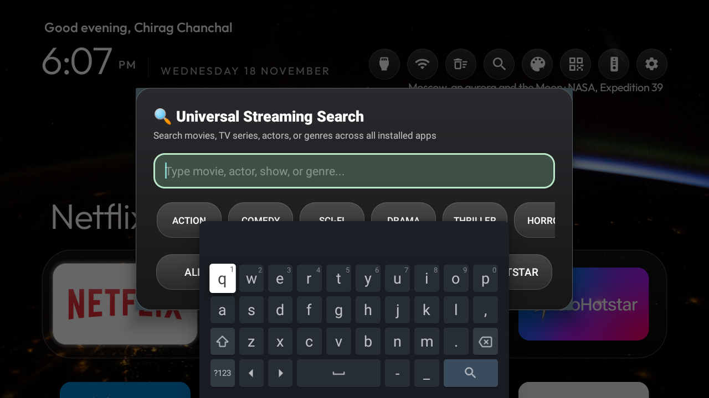

# 🍎 TrimOS

<div align="center">


### **Môi trường hoạt động siêu sạch, hoàn toàn không quảng cáo cho Android TV & Google TV**
*Biến mọi chiếc Smart TV chậm chạp, ngập tràn quảng cáo thành trải nghiệm siêu mượt lấy cảm hứng từ Apple TV.*

[](LICENSE)
[](https://android.com/tv)
[](#)
[](#)
[](#)

[English](README.md) • [Deutsch](README.de.md) • [Español](README.es.md) • [Français](README.fr.md) • [Italiano](README.it.md) • [Português (Brasil)](README.pt-BR.md) • [Nederlands](README.nl.md) • [Türkçe](README.tr.md) • [Ελληνικά](README.el.md) • [עברית](README.he.md) • [Українська](README.uk.md) • [Oʻzbekcha](README.uz.md) • [Tiếng Việt](README.vi.md) • [日本語](README.ja.md) • [简体中文](README.zh-CN.md) • [繁體中文](README.zh-TW.md)

[Tính năng](#-t%E1%BA%A1i-sao-n%C3%AAn-ch%E1%BB%8Dn-trimos) • [Hình ảnh](#-h%C3%ACnh-%E1%BA%A3nh-th%E1%BB%B1c-t%E1%BA%BF) • [Bắt đầu nhanh](#-b%E1%BA%AFt-%C4%91%E1%BA%A7u-nhanh) • [TV được hỗ trợ](#-c%C3%A1c-d%C3%B2ng-tv-%C4%91%C6%B0%E1%BB%A3c-h%E1%BB%97-tr%E1%BB%A3--h%E1%BB%93-s%C6%A1) • [Điều khiển di động](#-b%C3%A0n-di-chu%E1%BB%99t--nh%E1%BA%ADp-li%E1%BB%87u-t%E1%BB%AB-%C4%91i%E1%BB%87n-tho%E1%BA%A1i) • [Khôi phục](#-%EF%B8%8F-an-to%C3%A0n--kh%C3%B4i-ph%E1%BB%A5c-1-ch%E1%BA%A1m)

</div>

---

## ⚡ Tại sao nên chọn TrimOS?

Smart TV ngày nay tràn ngập quảng cáo video toàn màn hình, video tự động phát, các hàng nội dung được tài trợ và dịch vụ theo dõi ngầm chiếm tới 80% bộ nhớ RAM ít ỏi của thiết bị.

**TrimOS** thay thế hoàn toàn giao diện nặng nề của nhà sản xuất (Xiaomi PatchWall, đề xuất của Google TV, thanh tài trợ Fire TV...) bằng một môi trường thanh lịch, tốc độ cao và không gây xao nhãng lấy cảm hứng từ Apple TV:

| Tính năng | Smart TV Mặc định | TrimOS |
| :--- | :---: | :---: |
| **Quảng cáo & Video Tự phát** | ❌ Xuất hiện khắp mọi nơi | 🟢 **100% Không Quảng cáo** |
| **Mức Chiếm dụng RAM** | ❌ 600 MB – 1.2 GB | 🟢 **~22 MB (Cực kỳ nhẹ)** |
| **Độ Trễ & Giật Lag** | ❌ Chậm chạp, giật khung hình | 🟢 **Mượt mà chuẩn 60 fps** |
| **YouTube Không Quảng cáo** | ❌ Quảng cáo 30s liên tục | 🟢 **SmartTube tích hợp SponsorBlock** |
| **Nhập Mật khẩu** | ❌ Cực khổ bằng phím điều hướng | 🟢 **Quét mã QR và nhập từ điện thoại** |
| **Chuột Ảo / Bàn di cảm ứng** | ❌ Không hỗ trợ | 🟢 **Hỗ trợ rê, chạm & kéo thả đầy đủ** |
| **Tùy biến Giao diện** | ❌ 1 giao diện nhà sản xuất cố định | 🟢 **32 Giao diện có sẵn** |
| **Tìm kiếm Phim Toàn diện** | ❌ Giới hạn theo đối tác tài trợ | 🟢 **Tìm kiếm gộp trên nhiều nền tảng** |
| **Gán Phím Điều Khiển** | ❌ Các nút tài trợ bị khóa chết | 🟢 **Gán lại nút điều khiển tự do** |
| **Yêu cầu Root** | ⚠️ Nguy hiểm và rủi ro | 🟢 **Không cần Root (Qua ADB an toàn)** |

---

## 📸 Hình ảnh Thực tế

### 1. Giao diện Phong cách Apple TV & Lời chào Cá nhân hóa
> Màn hình chính trang nhã với hình nền vệ tinh NASA 4K chuyển động nhẹ nhàng, hiệu ứng nổi bật tinh tế và lời chào linh hoạt cho từng thành viên trong gia đình.
<div align="center">
  
</div>

---

### 2. 📱 Điều khiển Di động & Bàn di Chuột Ảo Hỗ trợ Kéo Thả
> Quét mã QR hoặc truy cập `http://<ip-tv>:8080` từ điện thoại trên cùng mạng Wi-Fi. Điều khiển con trỏ chuột êm ái, chạm để bấm, giữ để kéo thả thẻ ứng dụng và sử dụng các nút cuộn tiện lợi.
<div align="center">
  
</div>

---

### 3. 📺 Tích hợp SmartTube Không Quảng cáo
> Thiết lập sẵn SmartTube với tính năng SponsorBlock tự động (bỏ qua đoạn quảng cáo, intro và kêu gọi đăng ký kênh) cùng khả năng phát 4K mượt mà.
<div align="center">
  
</div>

---

### 4. 🎨 32 Giao diện Tích hợp Sẵn (Chuyển đổi Trực tiếp)
> Chuyển đổi tức thì giữa 32 phong cách trên màn hình TV hoặc từ điện thoại: **Aerial**, **Minimal (OLED Đen Tuyệt Đối)**, **Midnight Glass**, **Cực Quang**, **Rạp Chiếu Phim**, **Retro Thập niên 80 Synthwave**, **Lễ Hội** và nhiều hơn nữa.
<div align="center">
  
</div>

---

### 5. 🔍 Tìm kiếm Phim Đa Nền tảng
> Tìm kiếm đồng thời trên Netflix, SmartTube, Amazon Prime Video và Disney+ theo tên phim, diễn viên hoặc thể loại.
<div align="center">
  
</div>

---

### 6. 📱 Quét Mã QR & Nhập liệu Nhanh từ Điện thoại
> Không còn phải bấm từng ký tự mật khẩu bằng điều khiển TV. Quét mã QR và sử dụng bàn phím hoặc trình quản lý mật khẩu của điện thoại để dán thẳng vào TV.
<div align="center">
  
</div>

---

### 7. 🎛️ Gán lại Nút Bấm trên Điều khiển TV
> Gán lại các nút màu (Đỏ/Xanh lá/Vàng/Xanh dương), Menu, Quay lại hoặc các số để kích hoạt Dọn RAM, Tìm kiếm Toàn diện, Đổi Giao diện hoặc ứng dụng yêu thích.
<div align="center">
  
</div>

---

### 8. 🧹 Dọn dẹp RAM & Tối ưu Hóa 1 Chạm
> Giải phóng bộ nhớ RAM của TV ngay tức thì. Tự động đóng an toàn các tiến trình nền bị chiếm dụng và hiển thị số megabyte bộ nhớ đã thu hồi.
<div align="center">
  
</div>

---

### 9. 🌌 Trình Bảo vệ Màn hình Aerial Kiểu Apple TV
> Màn hình chờ sống động hiển thị những thước phim không gian tuyệt đẹp của Trái Đất từ NASA, quầng sáng chuyển động và đồng hồ chữ thanh mảnh.
<div align="center">
  
</div>

---

## 🚀 Bắt đầu Nhanh

### Yêu cầu Chuẩn bị
1. **Bật Tùy chọn Nhà phát triển và Gỡ lỗi ADB trên TV**:
   - Vào TV **Cài đặt** → **Tùy chọn thiết bị** → **Giới thiệu**.
   - Bấm liên tục 7 lần vào mục **Số bản dựng / Build** cho đến khi xuất hiện thông báo *"Bạn đã là nhà phát triển!"*.
   - Quay lại menu **Tùy chọn nhà phát triển** và bật **Gỡ lỗi USB** cùng **Gỡ lỗi mạng / ADB**.
2. Đảm bảo máy tính và TV đang kết nối chung một mạng Wi-Fi.

---

### Cài đặt Tự động 1 Chạm (Khuyên dùng)

Tải mã nguồn và chạy trình cài đặt tự động:

```bash
git clone https://github.com/chiragchanchal/TrimOS.git
cd TrimOS
```

#### Trên Windows:
```powershell
python trimos.py install --ip <IP_CỦA_TV>
# hoặc bấm đúp vào tệp trimos.bat
```

#### Trên macOS / Linux:
```bash
python3 trimos.py install --ip <IP_CỦA_TV>
```

*Trình cài đặt sẽ tự động nhận diện thương hiệu TV, cài tệp TrimOS APK, cố định phím Home vĩnh viễn, vô hiệu hóa quảng cáo rác an toàn và cài phiên bản SmartTube phù hợp với vi xử lý của bạn.*

---

### Cài đặt Thủ công (Không cần Python)

Nếu bạn đã cài sẵn công cụ `adb` trên máy tính:

```bash
# 1. Kết nối với TV
adb connect <IP_CỦA_TV>:5555

# 2. Cài đặt TrimOS
adb install -r -g release/TrimOS-v1.0.apk

# 3. Kích hoạt dịch vụ trợ năng cho phím Home và chuột ảo
adb shell settings put secure enabled_accessibility_services com.gathin.tvhome/.HomeKeyService
adb shell settings put secure accessibility_enabled 1

# 4. (Tùy chọn) Cài đặt SmartTube
# Dành cho TV 32-bit (Mi TV 4A/4C, FireStick...):
adb install -r release/SmartTube-v32.71-armeabi-v7a.apk
# Dành cho TV 64-bit (Shield TV, Google TV đời mới):
adb install -r release/SmartTube-v32.71-arm64-v8a.apk

# 5. Khởi chạy TrimOS
adb shell am start -n com.gathin.tvhome/.MainActivity
```

---

## 📺 Các Dòng TV Được Hỗ trợ & Hồ sơ

TrimOS tích hợp sẵn các hồ sơ xử lý tương thích riêng cho từng nhà sản xuất:

| Hãng / Nền tảng | Thiết bị Đã Kiểm tra | Những Gì TrimOS Dọn dẹp & Tối ưu |
| :--- | :--- | :--- |
| **Xiaomi / Redmi** | Mi TV 4A, 4C, 5X, Dòng X, Horizon, Redmi TV | Gỡ PatchWall, dải băng quảng cáo và kênh đề xuất. Các cổng HDMI và CEC vẫn hoạt động hoàn hảo. |
| **Google TV** | Chromecast Google TV (HD/4K), Sony Bravia, TCL | Tắt các băng chuyền quảng cáo trong `launcherx`. Google Cast và Play Store nguyên vẹn. |
| **Android TV Mặc định** | Sony Bravia, TCL, Hisense, Philips, Sharp, Skyworth | Thay thế giao diện Leanback chậm chạp. Các menu cài đặt âm thanh và hình ảnh của TV không bị ảnh hưởng. |
| **Amazon Fire TV** | Fire TV Stick 4K / Max, Fire TV Cube, Omni Series | Bỏ qua trang chủ ngập tràn nội dung mua sắm của Fire OS và khóa nút Home vào TrimOS. |
| **OnePlus TV** | OnePlus TV Q1, U1S, Y1S | Dọn sạch OxygenPlay và các dịch vụ đề xuất ngầm của hãng. |
| **TV Box Đa năng** | Nvidia Shield TV, Mecool, Dynalink, Formuler, X96 | Tối ưu hiển thị 60 fps với mức tiêu thụ RAM tối thiểu. |

---

## 📱 Bàn di Chuột & Nhập liệu từ Điện thoại

Mỗi chiếc TV cài TrimOS đều sở hữu một máy chủ web nội bộ siêu nhẹ, không phụ thuộc vào máy chủ đám mây:

1. Bấm vào **biểu tượng QR** trên thanh công cụ của TV (hoặc mở `http://<ip-tv>:8080` trên trình duyệt điện thoại).
2. **Bàn di Chuột Ảo**:
   - **Rê ngón tay**: Di chuyển con trỏ chuột mượt mà trên TV.
   - **Chạm nhẹ**: Bấm chọn (Click).
   - **Chế độ Kéo**: Bật **Drag Mode: ON** để giữ và kéo thẻ ứng dụng.
   - **Nút Cuộn**: Cuộn lên và cuộn xuống tiện dụng.
3. **Nhập liệu Nhanh**:
   - Soạn mật khẩu dài hoặc dán đường link trên điện thoại rồi bấm **"Send to TV Keyboard / Clipboard"**.
4. **Đổi Giao diện Tức thì**:
   - Thay đổi giao diện TV trực tiếp từ danh sách chọn trên điện thoại.

---

## 🛡️ An toàn & Khôi phục 1 Chạm

TrimOS hoạt động **hoàn toàn an toàn và không gây hỏng hóc**:
- Ứng dụng rác chỉ được tắt qua lệnh `pm uninstall -k --user 0 <gói>`, vô hiệu hóa riêng cho người dùng hiện tại mà không làm thay đổi phân vùng hệ thống gốc.
- Không xóa các tệp hệ thống cốt lõi và không cần quyền Root.

Để quay lại giao diện gốc của nhà sản xuất bất cứ lúc nào:

```bash
python trimos.py restore --ip <IP_CỦA_TV>
```

Lệnh này sẽ kích hoạt lại ngay lập tức giao diện mặc định (PatchWall, Google TV...).

---

## 🛠️ Lệnh CLI & Công cụ Tiện ích

Công cụ `trimos.py` đi kèm hỗ trợ quản lý TV toàn diện:

```bash
# Kiểm tra trạng thái kết nối, ứng dụng hiện tại và dung lượng RAM
python trimos.py status --ip 192.168.1.9

# Kích hoạt dọn dẹp RAM từ xa
python trimos.py clean --ip 192.168.1.9

# Đổi giao diện từ xa
python trimos.py theme --theme-name aurora --ip 192.168.1.9

# Chụp ảnh màn hình TV và lưu về máy tính
python trimos.py screenshot --ip 192.168.1.9

# Mở điều khiển web ngay trên trình duyệt máy tính
python trimos.py remote --ip 192.168.1.9
```

---

## 📁 Cấu trúc Thư mục Dự án

```
TrimOS/
├── release/                      # Các tệp APK đã đóng gói sẵn
│   ├── TrimOS-v1.0.apk           # Bản cài đặt TrimOS Launcher APK
│   ├── SmartTube-v32.71-armeabi-v7a.apk  # SmartTube không quảng cáo 32-bit
│   └── SmartTube-v32.71-arm64-v8a.apk    # SmartTube không quảng cáo 64-bit
├── docs/
│   └── screenshots/              # Hình chụp thực tế từ các màn hình TV
├── launcher/                     # Mã nguồn hoàn chỉnh dự án Android Studio
│   └── app/src/main/
│       ├── java/com/gathin/tvhome/
│       │   ├── MainActivity.java         # Giao diện Apple TV và bộ điều hướng
│       │   ├── HomeKeyService.java       # Dịch vụ trợ năng khóa phím Home
│       │   ├── BootReceiver.java         # Tự khởi chạy sau khi khởi động
│       │   ├── MouseController.java      # Con trỏ chuột ảo và bộ kéo thả
│       │   ├── TvHttpServer.java         # Máy chủ điều khiển web & nhập liệu
│       │   ├── ThemeManager.java         # Bộ quản lý 32 giao diện
│       │   ├── UniversalSearchHelper.java# Công cụ tìm kiếm phim đa nền tảng
│       │   ├── RemoteRemapHelper.java    # Trình quản lý gán nút điều khiển
│       │   └── QrCodeHelper.java         # Trình tạo mã QR nội bộ
│       └── assets/themes/                # 32 giao diện và hình nền tích hợp
├── trimos.py                     # Trình cài đặt và tiện ích dòng lệnh
├── trimos.bat                    # Phím tắt khởi chạy 1 chạm trên Windows
├── trimos.sh                     # Tệp khởi chạy trên Linux / macOS
├── LICENSE                       # Giấy phép MIT
└── README.md                     # Tài liệu hướng dẫn chính (Tiếng Anh)
```

---

## 📜 Giấy phép

Dự án này được phân phối dưới các điều khoản của **Giấy phép MIT** – xem chi tiết tại tệp [LICENSE](LICENSE).

---

<div align="center">
  <b>Được phát triển cho trải nghiệm xem TV nhanh hơn, sạch hơn và không còn phiền toái vì quảng cáo.</b><br>
  <sub>Nếu TrimOS mang lại giá trị cho chiếc TV của bạn, hãy dành tặng một ⭐️ trên GitHub nhé!</sub>
</div>
