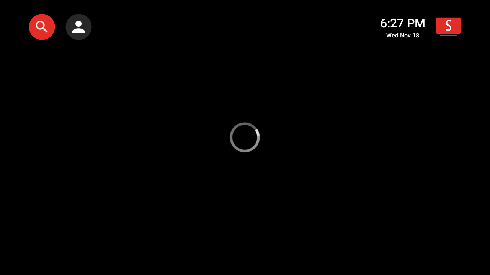

# 🍎 TrimOS

<div align="center">


### **专为 Android TV 与 Google TV 打造的极简、零广告纯净操作系统环境**
*将任何卡顿、广告泛滥的智能电视打造成如 Apple TV 般丝滑飞速的高端体验。*

[](LICENSE)
[](https://android.com/tv)
[](#)
[](#)
[](#)

[English](README.md) • [Deutsch](README.de.md) • [Español](README.es.md) • [Français](README.fr.md) • [Italiano](README.it.md) • [Português (Brasil)](README.pt-BR.md) • [Nederlands](README.nl.md) • [Türkçe](README.tr.md) • [Ελληνικά](README.el.md) • [עברית](README.he.md) • [Українська](README.uk.md) • [Oʻzbekcha](README.uz.md) • [Tiếng Việt](README.vi.md) • [日本語](README.ja.md) • [简体中文](README.zh-CN.md) • [繁體中文](README.zh-TW.md)

[核心特性](#-为什么选择-trimos) • [实机展示](#-界面实拍展示) • [快速开始](#-快速开始) • [支持电视型号](#-支持的电视与厂商配置文件) • [手机遥控器](#-手机触控板遥控--快速扫码输入) • [安全还原](#-安全保障--一键还原出厂)

</div>

---

## ⚡ 为什么选择 TrimOS？

如今的智能电视普遍充斥着全屏开机视频广告、不可关闭的自动播放预告片、赞助商推广栏目以及后台高频数据搜集服务，吞噬了电视本就匮乏的系统内存高达 80%。

**TrimOS** 完全取代电视厂商笨重的系统桌面（小米电视 PatchWall、Google TV 推广卡片、Fire TV 赞助栏等），为你带来极简、流畅且受 Apple TV 设计启发的纯净体验：

| 功能特性 | 原厂智能电视 | TrimOS |
| :--- | :---: | :---: |
| **视频广告与自动播放** | ❌ 无孔不入，频繁打扰 | 🟢 **100% 纯净无广告** |
| **系统内存（RAM）占用** | ❌ 600 MB – 1.2 GB | 🟢 **约 22 MB（极致轻巧）** |
| **开机响应与按键延迟** | ❌ 卡顿掉帧，反应迟缓 | 🟢 **满血 60fps 丝滑流畅** |
| **免广告 YouTube / 影视** | ❌ 经常穿插 30 秒广告 | 🟢 **集成 SmartTube 与 SponsorBlock** |
| **遥控器输入密码** | ❌ 依靠方向键苦不堪言 | 🟢 **手机扫码直接输入与粘贴** |
| **虚拟鼠标 / 触摸板** | ❌ 无原生支持 | 🟢 **支持拖拽的流畅手机触控板** |
| **主题个性化** | ❌ 仅限原厂单一固定壁纸 | 🟢 **内置 32 款精美主题** |
| **影视全平台聚合搜索** | ❌ 仅限商业推广合作内容 | 🟢 **主流流媒体统一聚合搜索** |
| **遥控器按键映射** | ❌ 赞助商专属按键锁死 | 🟢 **支持遥控器按键自由重映射** |
| **是否需要 Root 权限** | ⚠️ 存在变砖风险且繁琐 | 🟢 **无需 Root（安全 ADB 协议）** |

---

## 📸 界面实拍展示

### 1. Apple TV 极简风格主屏与动态家庭问候
> 高清 4K NASA 卫星航拍动态背景，配合灵动卡片微动效与贴心的家庭成员专属动态问候语。
<div align="center">
  
</div>

---

### 2. 📱 手机虚拟触控板与卡片拖拽
> 扫描屏幕二维码或直接在局域网手机浏览器访问 `http://<电视IP>:8080`。如物理鼠标般顺滑移动指针、轻触点击、长按拖拽卡片或进度条，并可使用专属页面滚动按钮。
<div align="center">
  
</div>

---

### 3. 📺 深度整合无广告 SmartTube
> 预置 SmartTube 高画质 4K 播放支持，内置 SponsorBlock 智能跳过片头、赞助广告与求关注片段。
<div align="center">
  
</div>

---

### 4. 🎨 内置 32 套精美主题（随时在屏切换）
> 可在电视或手机上秒切 32 款主题：**Aerial（航拍）**、**极简 OLED 纯黑**、**Midnight Glass（午夜琉璃）**、**极光**、**经典影院**、**80 年代蒸汽波**、**节日主题** 等。
<div align="center">
  
</div>

---

### 5. 🔍 流媒体全平台聚合搜索
> 一次搜索即可同时聚合检索 Netflix、SmartTube、Amazon Prime Video 及 Disney+ 的片名、演员或剧集。
<div align="center">
  
</div>

---

### 6. 📱 手机扫码直连与快捷键入
> 告别遥控器逐字敲密码的痛苦体验。扫描屏幕二维码，直接用手机键盘或密码管理器将长密码、复杂网址一键秒发至电视剪贴板。
<div align="center">
  
</div>

---

### 7. 🎛️ 遥控器按键映射工具
> 可将电视遥控器上的彩色键（红/绿/黄/蓝）、菜单键、返回键或数字键自定义映射为：一键内存清理、聚合搜索、主题切换或直达常用应用。
<div align="center">
  
</div>

---

### 8. 🧹 一键清理内存与极速优化
> 轻轻一点立即释放系统内存。安全中止后台驻留缓存，实时在屏幕提示已释放的内存空间（MB）。
<div align="center">
  
</div>

---

### 9. 🌌 Apple TV 风格航拍动态屏保
> 震撼的 NASA 4K 地球航拍壁纸、微光呼吸动效与高质感极简时钟屏保。
<div align="center">
  
</div>

---

## 🚀 快速开始

### 准备工作
1. **在电视上开启开发者选项与 ADB 调试**：
   - 打开电视 **设置** → **设备偏好设置** → **关于**。
   - 连续点击 **版本号（Build Number）** 7 次，直到屏幕提示 *“您现在处于开发者模式！”*。
   - 返回 **开发者选项**，开启 **USB 调试** 以及 **网络 / ADB 调试**。
2. 确保电脑与电视连接在同一个 Wi-Fi 局域网内。

---

### 一键全自动安装（强烈推荐）

克隆项目并运行通用安装脚本：

```bash
git clone https://github.com/chiragchanchal/TrimOS.git
cd TrimOS
```

#### Windows 用户：
```powershell
python trimos.py install --ip <你的电视IP>
# 或者直接双击运行 trimos.bat
```

#### macOS / Linux 用户：
```bash
python3 trimos.py install --ip <你的电视IP>
```

*安装程序会自动识别电视品牌、安装 TrimOS 应用、锁定 Home 主页键、安全停用厂商推广广告，并根据处理器架构自动安装匹配的免广告 SmartTube。*

---

### 手动安装（无需 Python 环境）

若电脑中已有 `adb` 工具：

```bash
# 1. 连接电视
adb connect <你的电视IP>:5555

# 2. 安装 TrimOS 主程序
adb install -r -g release/TrimOS-v1.0.apk

# 3. 启用主页键接管与触控板无障碍辅助服务
adb shell settings put secure enabled_accessibility_services com.gathin.tvhome/.HomeKeyService
adb shell settings put secure accessibility_enabled 1

# 4.（可选）安装 SmartTube
# 适用于 32 位电视（小米电视 4A/4C、FireStick 等）：
adb install -r release/SmartTube-v32.71-armeabi-v7a.apk
# 适用于 64 位电视（Nvidia Shield、新款 Google TV 等）：
adb install -r release/SmartTube-v32.71-arm64-v8a.apk

# 5. 启动 TrimOS
adb shell am start -n com.gathin.tvhome/.MainActivity
```

---

## 📺 支持的电视与厂商配置文件

TrimOS 内置专为各大品牌定制的软件优化方案：

| 品牌 / 系统 | 实机测试设备 | TrimOS 优化与清理详情 |
| :--- | :--- | :--- |
| **小米 / Redmi** | 小米电视 4A, 4C, 5X, X系列, Horizon, Redmi 电视 | 停用 PatchWall 桌面、视频横幅广告及推荐频道，完整保留 HDMI 输入通道与 CEC 联动。 |
| **Google TV** | Chromecast with Google TV, 索尼 Bravia, TCL | 关闭 `launcherx` 广告栏及赞助推广行，Google Cast 与 Play 商店照常正常工作。 |
| **标准原生 Android TV** | 索尼 Bravia, TCL, 海信 Hisense, 飞利浦, 夏普 | 替换笨拙的原厂 Leanback 桌面，电视原生音质和图像参数设置菜单丝毫不受影响。 |
| **亚马逊 Fire TV** | Fire TV Stick 4K / Max, Fire TV Cube, Omni 系列 | 绕过 Fire OS 复杂的商品推广主页，将 Home 键直接锁定为 TrimOS。 |
| **一加 OnePlus TV** | OnePlus TV Q1, U1S, Y1S | 清理 OxygenPlay 系统推广服务及后台推送进程。 |
| **通用外贸电视盒子** | Nvidia Shield TV, Mecool, Dynalink, Formuler, X96 | 极低内存开销下带来极致丝滑的 60 帧纯净体验。 |

---

## 📱 手机触控板遥控 & 快速扫码输入

安装了 TrimOS 的电视均内置低延迟本地微型 Web 服务器，无需连接外网云端服务：

1. 点击电视顶部导航栏的 **二维码图标**（或在手机浏览器输入 `http://<电视IP>:8080`）。
2. **手机虚拟触控板**：
   - **手指滑动**：在电视屏幕上平滑引导鼠标指针。
   - **轻触**：点击确认。
   - **拖拽开关**：开启 **Drag Mode: ON** 可长按拖拽卡片及调整进度。
   - **滚动键**：便捷上下滚动长列表页面。
3. **手机秒输文本**：
   - 在手机输入复杂账号密码或粘贴超长网址，点击 **"Send to TV Keyboard / Clipboard"** 即可秒传上屏。
4. **即时主题切换**：
   - 在手机下拉菜单中直接选择切换电视的主题视觉。

---

## 🛡️ 安全保障 & 一键还原出厂

TrimOS **绝对安全且完全可逆**：
- 系统精简仅通过 Android 标准指令 `pm uninstall -k --user 0 <包名>` 执行，仅对当前用户空间隐藏禁用，绝不修改底层的只读系统固件分区。
- 绝不删除任何关键底层文件，更无需获取 Root 权限。

随时可一键无损还原回电视原厂桌面：

```bash
python trimos.py restore --ip <你的电视IP>
```

原厂桌面（PatchWall、Google TV 等）将立刻复原，所有设置毫发无损。

---

## 🛠️ CLI 常用管理命令

内置的 `trimos.py` 脚本提供全套电视维护指令：

```bash
# 查看电视连接状态、前台活跃应用及当前内存占用
python trimos.py status --ip 192.168.1.9

# 远程触发电视内存快速释放清理
python trimos.py clean --ip 192.168.1.9

# 远程更换电视桌面主题
python trimos.py theme --theme-name aurora --ip 192.168.1.9

# 将电视当前画面截图并高清保存至电脑
python trimos.py screenshot --ip 192.168.1.9

# 在电脑浏览器中打开 Web 遥控面板
python trimos.py remote --ip 192.168.1.9
```

---

## 📁 项目目录结构

```
TrimOS/
├── release/                      # 开箱即用的预编译安装包
│   ├── TrimOS-v1.0.apk           # 预编译 TrimOS 桌面安装包
│   ├── SmartTube-v32.71-armeabi-v7a.apk  # 32位无广告版 SmartTube
│   └── SmartTube-v32.71-arm64-v8a.apk    # 64位无广告版 SmartTube
├── docs/
│   └── screenshots/              # 真实电视实拍界面高清截图
├── launcher/                     # 完整的 Android Studio 源码工程
│   └── app/src/main/
│       ├── java/com/gathin/tvhome/
│       │   ├── MainActivity.java         # Apple TV 风格核心交互与焦点控制
│       │   ├── HomeKeyService.java       # 主页键拦截与无障碍手势引擎
│       │   ├── BootReceiver.java         # 开机自动启动与保活监听
│       │   ├── MouseController.java      # 虚拟光标平滑控制与拖拽引擎
│       │   ├── TvHttpServer.java         # 本地 Web 遥控与输入服务器
│       │   ├── ThemeManager.java         # 32 套内置主题资源管理器
│       │   ├── UniversalSearchHelper.java# 全平台影视聚合搜索模块
│       │   ├── RemoteRemapHelper.java    # 遥控器按键映射管理器
│       │   └── QrCodeHelper.java         # 二维码快速生成工具
│       └── assets/themes/                # 32 套内置主题样式与壁纸
├── trimos.py                     # 跨平台一键部署与管理工具
├── trimos.bat                    # Windows 一键执行入口
├── trimos.sh                     # Linux / macOS 执行入口
├── LICENSE                       # MIT 开源许可证
└── README.md                     # 英文原版主文档
```

---

## 📜 开源协议

本项目基于 **MIT 许可证** 协议开源 – 详情请参阅 [LICENSE](LICENSE) 文件。

---

<div align="center">
  <b>专注于更纯粹、更迅捷、无广告的客厅大屏观影体验。</b><br>
  <sub>如果 TrimOS 让你的电视重获新生，欢迎在 GitHub 上点亮一颗 ⭐️！</sub>
</div>
